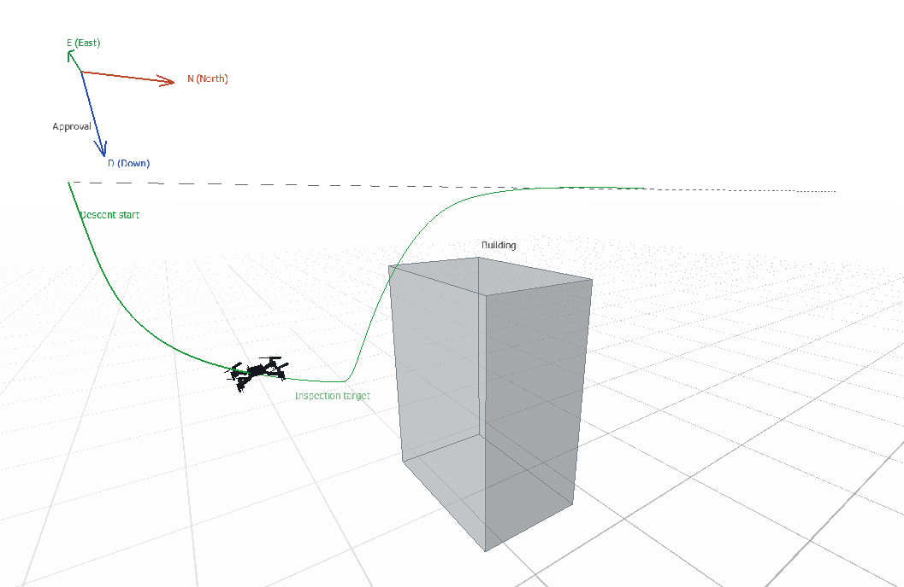
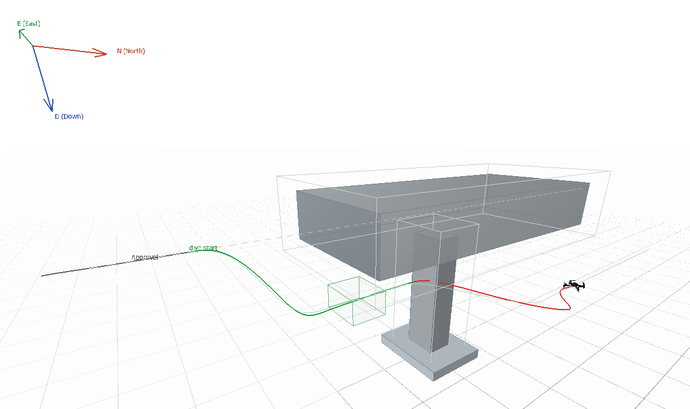

# StaleGuard

**StaleGuard: When to Stop Waiting -- Runtime Assurance for Queued UAV Commands**

Modern AI-agent-assisted UAV systems separate planning from execution. In such systems, an approved UAV command can become stale while waiting for an unknown dispatch time. StaleGuard predicts three time-dependent opportunities: safe command execution, safe mission completion, and safe recovery. It monitors the pending command to decide when to intervene before dispatch.

## Benchmark Missions

StaleGuard is evaluated on three UAV missions using Safe-Control-Gym and PyBullet physics.

| Inspection Descent | Geofence Turn | Underpass Inspection |
|:---:|:---:|:---:|
|  |  |  |

## Installation

Use **Python 3.10** and the versions in `requirements-reproduction.txt`. We recommend Conda to create a clean environment.

First, clone the repository and download the recorded experimental data. **Git LFS is required** for the large Underpass execution journal and the robustness record archive:

```bash
git lfs install
git clone https://github.com/AnPatapain/StaleGuard.git
cd StaleGuard
git lfs pull
```

Then install the Python dependencies:

```bash
conda create -n staleguard-repro python=3.10 pip -y
conda activate staleguard-repro
export PYTHONNOUSERSITE=1

python -m pip install -r requirements-reproduction.txt
python -m pip install -e . --no-deps
python -m pip check
```

`PYTHONNOUSERSITE=1` prevents packages installed in your user directory from interfering with the Conda environment. Set it again in any new terminal where you run the reproduction commands, or configure it permanently for that environment.

The Safe-Control-Gym code and simulator assets used by this project are already included in `safe_control_gym/`. You do **not** need to install a separate copy of Safe-Control-Gym.

## Recorded Data

The repository includes the experimental records needed to reconstruct the paper's results. Most files download with Git; two large files download through Git LFS:

| File | Contents |
| --- | --- |
| `data/underpass_inspection/benchmark/executions.jsonl` | Original Underpass benchmark flight records |
| `data/underpass_inspection/robustness_v1/records.tar.gz` | E01 robustness simulation and prediction records |

After `git lfs pull`, verify both files:

```bash
git lfs ls-files

wc -c data/underpass_inspection/benchmark/executions.jsonl
sha256sum data/underpass_inspection/benchmark/executions.jsonl

wc -c data/underpass_inspection/robustness_v1/records.tar.gz
sha256sum data/underpass_inspection/robustness_v1/records.tar.gz
```

The original Underpass benchmark journal should be **176,132,260 bytes**, with SHA-256:

```text
8692aa2d9b1bb7cfb8b111743f92aff0c329862292862ee7e84639e5bac8f2e6
```

The robustness archive is verified against its dataset manifest using:

```bash
python -m staleguard.robustness verify-archive --data-root data
```

See [data/README.md](data/README.md) for dataset contents and integrity-check instructions.

## Reproduce Paper Results

These commands reconstruct the paper's tables and figures from recorded data, **without rerunning the simulations**:

```bash
# Figure 2 — Underpass flight trajectories
python -m staleguard.reproduce.fig2 --data-root data --out outputs/fig2

# Figure 3 — Physical feasibility opportunities
python -m staleguard.reproduce.fig3 --data-root data --out outputs/fig3

# Table II — Prediction accuracy and computational readiness
python -m staleguard.reproduce.table2 --data-root data --out outputs/table2

# Table III — Safety and mission completion across eight policies
python -m staleguard.reproduce.table3 --data-root data --out outputs/table3

# Figure 4 — Underpass outcomes versus dispatch delay
python -m staleguard.reproduce.fig4 --data-root data --out outputs/fig4

# Figure 5 — Safety–completion trade-off
python -m staleguard.reproduce.fig5 --data-root data --out outputs/fig5
```

Figures are exported as PDF/PNG and tables as CSV/Markdown, together with their numerical data.

The commands above use the archived records. To generate new physical simulation records instead, use the experiment runner described below.

## Robustness Evaluation

We also evaluate StaleGuard under imperfect dynamics and state observations. The study uses 64 Underpass scenarios, five conditions (nominal, ±5% and ±10% mass mismatch, and two levels of observation error), six policies, and 13 dispatch delays.

The results and supporting records are available in [the robustness dataset](data/underpass_inspection/robustness_v1/README.md).

To verify the data and reproduce the results without rerunning simulations:

```bash
python -m staleguard.robustness verify-archive --data-root data

python -m staleguard.robustness reproduce \
  --data-root data \
  --out outputs/robustness_reproduced
```

The study's limitations and the small timing differences from the original benchmark are documented in the dataset.

## Run New Experiments

Run a physical PyBullet evaluation using the existing mission configurations and policies. For example, a small Underpass benchmark:

```bash
python -m staleguard.reproduce.run_experiments \
  --data-root data \
  --mission underpass_inspection \
  --experiment benchmark \
  --seeds 1002 \
  --policies no_recovery staleguard_dual_horizon \
  --delays 0 \
  --max-records 2 \
  --workers 1 \
  --out outputs/runs/underpass-example
```

Supported experiment types are `benchmark`, `feasibility`, `prediction`, and `calibration`.

Use `--help` for more options. New experiments require an empty output directory and do not overwrite the archived data.

## PyBullet Visualization

Launch interactive UAV simulations:

```bash
# Inspection Descent
python -m staleguard.visualize --mission inspection_descent --seed 20 --delay 0

# Geofence Turn
python -m staleguard.visualize --mission geofence_turn --seed 22 --delay 0.5

# Underpass Inspection
python -m staleguard.visualize --paper-figure --overlay-all
```

Visualization requires a desktop display. Use `python -m staleguard.visualize --help` for more options.

## Additional Information

- [Dataset documentation](data/README.md) — Experimental records and integrity checks.
- [Citation](CITATION.cff) — Citation information.
- [License](LICENSE) — License information.