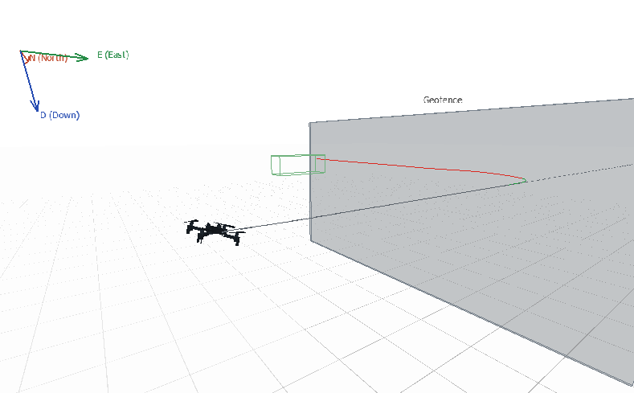

# StaleGuard

**StaleGuard: When to Stop Waiting -- Runtime Assurance for Queued UAV Commands**

Modern AI-agent-assisted UAV systems separate planning from execution. In such systems, an approved UAV command can become stale while waiting for an unknown dispatch time. StaleGuard predicts three time-dependent opportunities: safe command execution, safe mission completion, and safe recovery. It monitors the pending command to decide when to intervene before dispatch.

## Benchmark Missions

StaleGuard is evaluated on three UAV missions using Safe-Control-Gym and PyBullet physics.

| Inspection Descent | Geofence Turn | Underpass Inspection |
|:---:|:---:|:---:|
|  |  |  |

## Installation

Use **Python 3.10** and the versions in `requirements-reproduction.txt`. We recommend Conda to create a clean environment.

First, clone the repository and download the recorded experimental data. **Git LFS is required** for the large Underpass execution journal and the robustness record archive:

```bash
git lfs install
git clone https://github.com/AnPatapain/StaleGuard.git
cd StaleGuard
git lfs pull
```

Then install the Python dependencies:

```bash
conda create -n staleguard-repro python=3.10 pip -y
conda activate staleguard-repro
export PYTHONNOUSERSITE=1

python -m pip install -r requirements-reproduction.txt
python -m pip install -e . --no-deps
python -m pip check
```

`PYTHONNOUSERSITE=1` prevents packages installed in your user directory from interfering with the Conda environment. Set it again in any new terminal where you run the reproduction commands, or configure it permanently for that environment.

The Safe-Control-Gym code and simulator assets used by this project are already included in `safe_control_gym/`. You do **not** need to install a separate copy of Safe-Control-Gym.

## Recorded Data

The maintained implementation is in `staleguard/`, alongside the bundled simulator in `safe_control_gym/`. Published experimental records are kept separately in `data/` and are never overwritten by the simulation runners.

After downloading the Git LFS files, verify the complete datasets with:

```bash
python -m staleguard.reproduce.verify --data-root data
```

This checks file sizes and SHA-256 checksums, the complete 121,088-outcome benchmark grid, and the E01 archive. You can also check the two LFS files directly:

```bash
sha256sum data/underpass_inspection/benchmark/executions.jsonl
sha256sum data/underpass_inspection/robustness_v1/records.tar.gz
```

The expected checksums and dataset contents are listed in [data/README.md](data/README.md).

## Reproduce Paper Results

These commands reconstruct the paper's tables and figures from recorded data, **without rerunning the simulations**:

```bash
# Figure 2 — Underpass flight trajectories
python -m staleguard.reproduce.fig2 --data-root data --out outputs/fig2

# Figure 3 — Physical feasibility opportunities
python -m staleguard.reproduce.fig3 --data-root data --out outputs/fig3

# Table II — Prediction accuracy and computational readiness
python -m staleguard.reproduce.table2 --data-root data --out outputs/table2

# Table III — Safety and mission completion across eight policies
python -m staleguard.reproduce.table3 --data-root data --out outputs/table3

# Figure 4 — Underpass outcomes versus dispatch delay
python -m staleguard.reproduce.fig4 --data-root data --out outputs/fig4

# Figure 5 — Safety–completion trade-off
python -m staleguard.reproduce.fig5 --data-root data --out outputs/fig5
```

Figures are exported as PDF/PNG and tables as CSV/Markdown, together with their numerical data.

The commands above use the archived records. To generate new physical simulation records instead, use the experiment runner described below.

## Robustness Evaluation

We also evaluate StaleGuard under imperfect dynamics and state observations. The study uses 64 Underpass scenarios, five conditions (nominal, ±5% and ±10% mass mismatch, and two levels of observation error), six policies, and 13 dispatch delays.

The results and supporting records are available in [the robustness dataset](data/underpass_inspection/robustness_v1/README.md).

To verify the data and reproduce the results without rerunning simulations:

```bash
python -m staleguard.robustness verify-archive --data-root data

python -m staleguard.robustness reproduce \
  --data-root data \
  --out outputs/robustness_reproduced
```

The study's limitations and the small timing differences from the original benchmark are documented in the dataset.

## Run New Experiments

The experiment runner uses the current implementation to make predictions and execute new PyBullet flights. It loads the published scenario parameters and validates the independently captured approval states against the frozen inputs. It does not copy archived physical outcomes into a fresh benchmark.

For a small evaluation of all eight policies on one Underpass scenario:

```bash
python -m staleguard.reproduce.run_experiments \
  --data-root data --mission underpass_inspection --experiment benchmark \
  --seeds 1002 --delays 0 0.2 --workers 1 \
  --out outputs/runs/underpass-small
```

Compare that run with the corresponding published trials:

```bash
python -m staleguard.reproduce.compare \
  --data-root data --mission underpass_inspection \
  --run outputs/runs/underpass-small --out outputs/comparisons/underpass-small
```

Predictions and physical trajectories can be deterministic on identical inputs, but measured computation times depend on the machine and its load. Those times determine forecast readiness, so fresh policy decisions can differ near a dispatch or intervention boundary. The comparison reports actions, safety, completion, runtime and trajectory hashes separately. An action difference needs a readiness check before it can be attributed to an algorithm mismatch.

The runner supports `benchmark`, `feasibility`, `prediction`, and `calibration`. Use `feasibility` for independent command/recovery flights, or `prediction` for three-opportunity forecasts. All runs require a fresh output directory. The small snapshot reader resolves class names in the original calibration pickles to the current classes; no historical source checkout is needed. Original snapshots remain unchanged.

### Complete evaluation

Omit scenario, policy and delay filters to evaluate each complete frozen grid with all eight policies:

```bash
python -m staleguard.reproduce.run_experiments \
  --data-root data --mission inspection_descent --experiment benchmark \
  --workers 2 --out outputs/runs/inspection-complete

python -m staleguard.reproduce.run_experiments \
  --data-root data --mission geofence_turn --experiment benchmark \
  --workers 2 --out outputs/runs/geofence-complete

python -m staleguard.reproduce.run_experiments \
  --data-root data --mission underpass_inspection --experiment benchmark \
  --workers 2 --out outputs/runs/underpass-complete
```

These cover 24,288, 55,200 and 41,600 policy trials respectively: 121,088 in total. The benchmark runner currently executes one new physical flight per requested trial. Its progress file records policy outcomes, physical executions, prediction computations and reuse separately. The archived benchmarks and E01 contain legitimate physical reuse; their policy-outcome totals should not be described as counts of distinct simulated flights.

### Fresh robustness runs

The locked E01 results are reconstructed with the commands above. To generate a separate physical robustness evaluation using the same 64-scenario design, run:

```bash
python -m staleguard.robustness pilot --workers 2 --out outputs/runs/e01-pilot
python -m staleguard.robustness run --workers 2 --out outputs/runs/e01-fresh
```

The first command is a bounded pilot; the second requests the full design. Repeat a command with the same output directory to resume it. E01 verifies nominal physical equivalence before reusing nominal flights and keeps mass-perturbed physical records separate. Its execution summary distinguishes new rollouts, cache reuse, policy outcomes and forecasts. Neither command changes the published dataset.

## Validation

```bash
python -m staleguard.reproduce.tests
python -m staleguard.robustness test --out outputs/runs/e01-pilot
```

The focused tests cover expiration, later feasible completion opportunities, readiness, dispatch rejection, cancellation, data integrity and physical reuse. The E01 integration tests also exercise actual mass and supervisory observation perturbations. A complete rerun of all 121,088 policy trials is much larger than these checks; bounded validation does not establish complete fresh-run numerical equivalence.

## PyBullet Visualization

Launch interactive UAV simulations:

```bash
# Inspection Descent
python -m staleguard.visualize --mission inspection_descent --seed 20 --delay 0

# Geofence Turn
python -m staleguard.visualize --mission geofence_turn --seed 22 --delay 0.5

# Underpass Inspection
python -m staleguard.visualize --paper-figure --overlay-all
```

Visualization requires a desktop display. Use `python -m staleguard.visualize --help` for more options.

## Additional Information

- [Dataset documentation](data/README.md) — Experimental records and integrity checks.
- [Citation](CITATION.cff) — Citation information.
- [License](LICENSE) — License information.