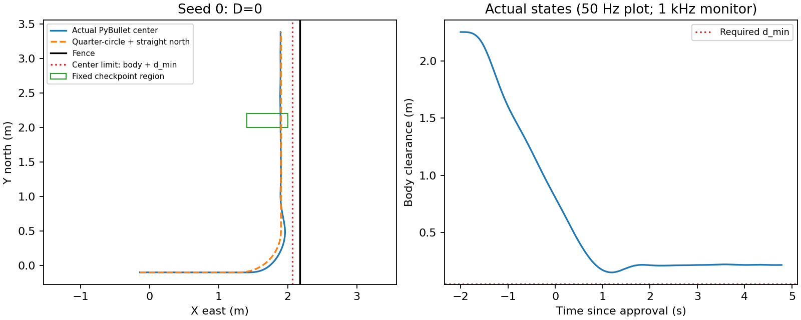

# Geofence mission correction: turn + northbound checkpoint

**Implemented and validated:** five regenerated development scenarios pass D=0 calibration and replay; 22 unit tests, four integration tests, and 26 existing Inspection-Descent tests pass. No baseline matrix or 300-scenario calibration was run. All new evidence is under [logs/northbound_review/](logs/northbound_review/).

## Mismatches found and fixed

- The quintic connector pulled the trajectory west toward a point. Removed it completely. The reference now makes one fixed-radius 90-degree left quarter-circle and then continues straight +Y, at constant X/Z and the approved speed. It has no terminal hold, endpoint follower or route search.
- The previous completion rule required stopping at a point. Replaced it with a **fixed world-frame checkpoint box** and a northbound pass requirement. Position must be inside the box, velocity within **0.12 m/s of (0, approved_speed, 0)**, continuously for **0.20 s**, before T.
- The old generator could put its target outside the fence. The new checkpoint box must fit wholly inside the body-safe half-space. Incompatible sampled geometry is explicitly rejected; radius is not resampled to rescue it.
- Old connector datasets and snapshots could otherwise be confused with current results. Current scenarios carry schema `northbound_checkpoint_v2`; old scenario loading and old prediction snapshots are explicitly rejected. Historical results are preserved and do not validate the corrected mission.
- Completion now checks the actual deadline explicitly; non-grid caller deadlines are covered through the next control endpoint without allowing completion after T. Generated deadlines are frozen on the 50 Hz grid before calibration.

## Frozen geometry, completion and calibration

The nominal +X reference and 0.4 s acceleration ramp remain. Dispatch anchors the approved arc at that step's nominal reference row, with the existing reference-editing semantics. Only the start position/time changes with dispatch delay; radius, speed, direction, checkpoint and deadline remain frozen. Checkpoint coordinates are never used in trajectory construction. Unit tests verify that moving the checkpoint cannot change the reference and that a delayed lane can miss it rather than reconnect to it.

The provisional region has **0.60 m east-west width**, **0.10 m north and altitude half-extents**, and north center `initial_y + radius + speed*2 s`. Its X center is sampled once from the geometric range that fits the fixed width inside the fence and overlaps lanes reachable after the minimum approval time. These settings were fixed before this characterization/calibration; they were not selected using delayed policies. The velocity tolerance and dwell retain their numeric values; the velocity target changes from zero to the approved northbound patrol velocity to match the requested pass-through mission. T is sampled as arc duration + 2 s nominal north travel + uniform[1,2] s allowance, then rounded to the 50 Hz grid.

The existing body approximation is unchanged: a **0.061288253 m** sphere enclosing SCG's collision cylinder. Signed body clearance is `fence_x - actual_x - body_radius`, required >= **0.05 m**. Actual PyBullet position and velocity are observed at **1000 Hz**, including the initial/final samples. Predispatch violations remain violations. Safety monitoring continues through approval+T after checkpoint completion.

Calibration samples one empirically feasible radius and one checkpoint before searching. The 0.2 s descending approval grid starts after the ramp (>=0.6 s); its upper bound comes from an actual nominal fence-violation probe. Latest approval maximizes nominal pre-turn patrol distance `v*(approval-0.2)`. Actual progress is logged separately. Every later candidate was simulated and rejected or ruled out by the already-unsafe nominal prefix. There is no delayed-dispatch or policy result in calibration.

## Small regenerated dataset and tests

The nine unchanged speed/radius screen pairs were rerun with the corrected northbound reference. **8/9 pass** the unchanged 0.15 m tracking screen; 0.8 m/s at R=0.2 m fails at **0.1578 m**. All nine reach their checkpoint under the physical pass predicate. [Raw characterization](logs/northbound_review/characterization/sweep.jsonl).

Ten seeds were pregenerated. Calibration stopped after **five attempted seeds (0–4), all accepted**, reaching the predeclared target of five. Seeds 5–9 were not attempted; generated seed 5 has an explicitly logged incompatible checkpoint geometry. There were **33 candidate flights**, five nominal bound probes and five exact D=0 replays, for **43 calibration/replay flights**. Of the 28 rejected approval candidates, 23 violated clearance and all 28 missed checkpoint completion; these categories overlap. The audit verifies unique descending progress values, unchanged command/region, and every later-on-grid candidate's failure.

| Seed | Speed m/s / radius m | Approval s | Actual pre-turn progress m | Minimum body clearance m | Completion / T s |
|---|---|---|---|---|---|
| 0 | 0.8 / 0.6 | 2.0 | 1.445 | 0.152797 | 3.246 / 4.78 |
| 1 | 0.6 / 0.4 | 1.8 | 0.964 | 0.341904 | 3.068 / 4.88 |
| 2 | 0.8 / 0.4 | 1.8 | 1.289 | 0.270010 | 2.866 / 3.98 |
| 3 | 0.8 / 0.4 | 1.4 | 0.960 | 0.085498 | 2.864 / 4.26 |
| 4 | 0.8 / 0.6 | 1.4 | 0.960 | 0.428567 | 3.250 / 4.98 |

All five calibration replays match approval state and PID history exactly. Each seed stores its frozen JSON scenario/configuration, approval snapshot, candidate journal and actual D=0 trace. [Dataset summary](logs/northbound_review/development/summary.json).

- **22 unit tests pass:** turn direction, C1 position/velocity continuity, constant post-turn X, nonnegative reference VX, analytic/vectorized equivalence, fixed region across candidates/delays, delayed misses, northbound completion versus stationary fallback, deterministic generation, geometry rejection, latest-progress calibration, legacy-data rejection and existing scheduling conventions. [Log](logs/northbound_review/unit_tests.log).
- **4 integration tests pass:** three fresh SCG/PyBullet flights plus checks of the measured turns at 0.4/0.6/0.8 m/s and R=0.4 m. The fresh D=0 run is safe and completes. At D=0.6, seed 0 retains the original region, misses it, and violates body clearance (minimum **-0.337344 m**); it does not reconnect west. A deliberately longer wait preserves its predispatch violation. [Log](logs/northbound_review/integration_tests.log), [flight artifacts](logs/northbound_review/integration/).
- **26 Inspection-Descent regression tests pass**, with that directory unmodified. [Log](logs/northbound_review/inspection_descent_regression.log).
- **Artifact audit passes** for all five accepted cases and 33 unique calibration candidates, reference monotonicity, physical sample counts, frozen regions, snapshot checksums and safe D=0 completion. [Audit](logs/northbound_review/artifact_validation.json).

The figure shows 50 Hz actual states; extrema and outcomes use the 1000 Hz monitor. It was rendered and visually inspected.

## Resource stops and remaining limitations

The unchanged 2 GiB available-memory guard interrupted characterization after six pairs and calibration after four completed seeds. Their journals were resumed without rerunning completed flights/candidates; source/configuration checks prevent mixing protocols. A separate optional replay command stopped after seed 0 at the same guard; it does **not** constitute a five-case standalone replay. All five required D=0 replays had already passed inside calibration, and the fresh integration replay also passed. The memory stops and partial optional command are retained in the logs; no limit was weakened.

**Actual PID settling remains:** although the reference never travels west, the unchanged PID corrects eastward overshoot with **5.8–9.7 cm** of measured post-arc westward motion across these five cases. This is tracking correction around a constant-X reference, not an artificial westbound route. Strictly monotonic actual X is not established and would require separate controller/trackability work. No controller or dynamics changes were made to suppress it. Region dimensions, velocity tolerance and dwell remain provisional physical mission choices. Characterization is a small empirical grid, not a general flight envelope.

No current StaleGuard/Use-Time/FBS/Periodic comparative performance is claimed; the historical connector baseline results are obsolete for this mission.

## Files and reproduction

Changed existing files only: `mission.py`, `scenario.py`, `simulation.py`, `prediction.py`, `cli.py`, `validation.py`, `diagnostics.py`, `tests/test_mission.py`, `tests/test_prediction.py`, `tests/test_integration.py`, `README.md`, and this report. No new Python files or architecture refactor. Inspection-Descent source/results and the pre-existing task-document modification are preserved. The prior report is [archived](logs/northbound_review/original_PHASE1_REPORT.md); old datasets/results remain in their original directories. [Correction diff](logs/northbound_review/correction.patch).

See [README.md](README.md) for the serial `scg` commands. New output directories are required. Interrupted characterization/calibration can use `--resume`; completed results and cached rejected candidates are retained with configuration/source verification. Do not overlap simulation workers. This correction ran nine characterization flights, 43 calibration flights, one standalone optional replay and three fresh integration flights (**56 total**, **zero baseline flights**).
