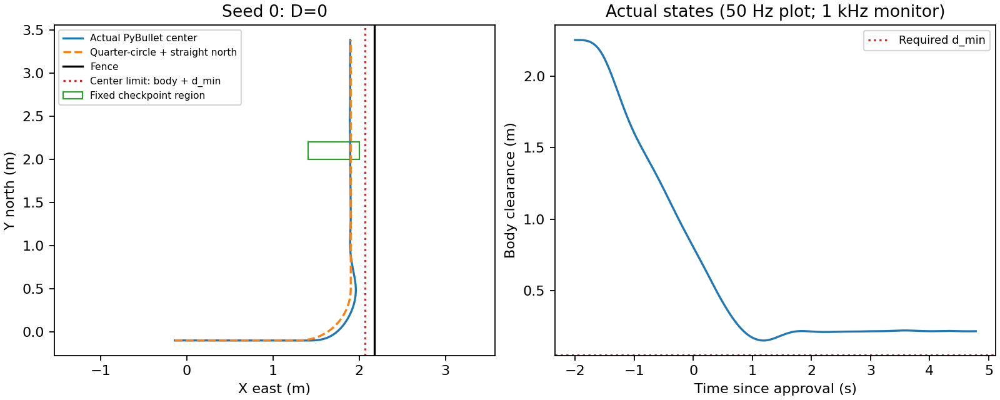

# Phase 1 technical appendix

This appendix records how the experiment was defined, which measurements support the [main report](PHASE1_REPORT.md), and how to reproduce the work. It adds explanations and references, not new experiments. The mission flights and the diagnostic timing benchmark are kept separate because they answer different questions: the flights show what the aircraft actually does, while the benchmark measures how long its safety forecast takes to compute.

## A. The flight and its fixed checkpoint

### How the turn starts

The UAV begins at rest and follows a planned eastbound patrol. Its requested speed rises linearly during the first 0.4 s, then stays constant. When the turn command is dispatched, we replace the remaining planned path with a left quarter-circle followed by straight northward flight. This is what the earlier report called “reference editing”: changing the positions and velocities requested from the existing SCG position controller, rather than changing the vehicle dynamics or selecting a new route.

The arc begins at the **planned** patrol position at dispatch, not at a new position calculated from the measured UAV state. If that position is `(x_start, y_start, z_start)`, the approved speed is `v`, and radius is `R`, the requested arc is:

```text
theta = v * time_since_dispatch / R
x = x_start + R * sin(theta)
y = y_start + R * (1 - cos(theta))
vx = v * cos(theta)
vy = v * sin(theta)
```

At `theta=pi/2`, requested X becomes constant at `x_start+R` and the UAV is asked to continue north at speed `v`. Z stays constant throughout. Position and velocity join continuously at the turn boundaries, although acceleration changes when the curve starts and ends. There is no final stop and no path back toward the checkpoint.

**Illustration, not a measured flight:** at 0.6 m/s, a 0.5 s delay moves the turn 0.3 m east. Suppose the radius is 0.4 m and the fixed checkpoint spans X=1.0–1.6 m:

| Requested position | Immediate dispatch | Dispatch delayed 0.5 s |
|---|---|---|
| Turn starts at X | 1.0 m | 1.3 m |
| Turn ends at X | 1.4 m | 1.7 m |
| Northbound path relative to that checkpoint | Inside its X range | Outside its X range |

The second path is not adjusted west to recover the checkpoint. This preserves the question being studied: whether the **same approved command** becomes unsuitable while waiting.

### How the checkpoint is sampled

The checkpoint is an inclusive rectangular box with fixed world coordinates. Its full dimensions are 0.60 m in X, 0.20 m in Y, and 0.20 m in Z. Its center is selected before calibration and remains unchanged for every approval candidate and dispatch delay.

The north center is `initial_y + R + v*2 s`. The arc itself gains R metres north, so the box lies another two seconds of nominal northward travel beyond the arc. For example, with initial Y=0, R=0.4 m and v=0.8 m/s, its north center is `0+0.4+0.8*2=2.0 m`. Its altitude center is the usual patrol height.

The east-west center is sampled once from a geometric interval. The box must fit inside the body-safe side of the fence and include positions that a post-ramp turn could reach. With width W=0.60 m, minimum approval time 0.6 s, body radius `r_body` and required body gap `d_min`, the interval is:

```text
earliest_northbound_X = initial_x + v*(0.6 - 0.2) + R
minimum_checkpoint_center_X = earliest_northbound_X + W/2
maximum_checkpoint_center_X = fence_x - r_body - d_min - W/2
```

If the minimum exceeds the maximum, the sampled geometry is rejected and logged. We do not change the radius or move the checkpoint during approval-time search. These geometric constraints make the checkpoint physically admissible; they do not guarantee that the actual controller can complete the mission.

### What counts as completion

Actual position must remain within all three checkpoint bounds while actual velocity stays within a **3D vector distance of 0.12 m/s** from `(0,v,0)`, for at least 0.20 s continuously. A stationary hover therefore does not satisfy completion. The qualifying interval must finish before T, measured from approval, and safety must still hold for the entire monitored horizon.

T is sampled once before calibration:

```text
arc_duration = pi*R/(2*v)
T = arc_duration + 2 s + a uniform random allowance between 1 and 2 s
```

The generated value is rounded to the 50 Hz controller grid, whose steps are 0.02 s. The extra 1–2 s is time allowance, not extra mandatory travel. For any non-grid deadline supplied by another caller, execution covers the next control endpoint, but completion after the requested T is not counted.

| Setting | Value | Status / reason |
|---|---|---|
| Eastbound acceleration ramp | 0.4 s | Existing mission convention |
| Checkpoint X width | 0.60 m | Provisional mission requirement |
| Checkpoint Y and Z half-widths | 0.10 m each | Provisional mission requirement |
| Northward distance beyond arc | v × 2 s | Provisional placement rule |
| Velocity tolerance | 0.12 m/s around `(0,v,0)` | Provisional passing requirement |
| Continuous time inside region | 0.20 s | Provisional passing requirement |
| Deadline allowance | Uniform 1–2 s | Provisional time budget |

These settings were fixed before the corrected experiments. They have not been validated as general requirements for a real UAV.

## B. Safety and physical tracking

SCG represents its collision body as a cylinder with radius 0.06 m and full length 0.025 m. We enclose this cylinder in a sphere so that the same conservative body-size check can be used at any aircraft orientation:

```text
r_body = sqrt(0.06^2 + (0.025/2)^2) = 0.061288253 m
body_clearance = fence_x - actual_center_x - r_body
safe when body_clearance >= 0.05 m
```

The source geometry is [SCG's cf2x.urdf](../../../safe_control_gym/envs/gym_pybullet_drones/assets/cf2x.urdf). The sphere covers that simulated collision shape; it is not a verified envelope for a real aircraft's propellers or sensors. The body radius and required 5 cm clearance are each included once.

For example, a center at X=2.3 m with a fence at X=2.5 m has about `2.5-2.3-0.0613=0.1387 m` body clearance. A clearance of 0.04 m is already a safety failure, even though the modeled body has not crossed the fence plane. Negative clearance means part of the modeled body has crossed it.

Actual PyBullet position and velocity are observed every physics step, at 1000 Hz. This includes the initial and final samples and the waiting period before dispatch. The recorded safety outcome remains failed after any violation, even if the UAV later turns away. Monitoring continues until approval+T after a successful checkpoint pass.

The safety predictor is a separate calculation. It uses the unchanged lightweight vehicle model with 100 Hz internal integration and 50 Hz control updates. Its clearance checks cover straight segments between consecutive predicted control states. For a sphere against a flat X boundary, the minimum clearance along such a straight segment is at an endpoint. This geometric fact does not remove errors from the approximate dynamics or from representing a curved motion by segments. Predicted safety still needs comparison with actual delayed PyBullet flights.

The position controller was not modified. Across the five selected D=0 traces, it corrected turn overshoot with 5.8–9.7 cm of westward movement after the arc. Thus the requested path has no westbound segment, while actual X is not strictly monotonic. If strictly non-westward physical motion is required, these flights do not meet that stronger condition; changing that would require a separate controller/trackability study.

## C. Turning tests and scenario generation

The turning screen used height 1.25 m and approval at 1.2 s, with nine speed/radius combinations. All nine passed through the checkpoint, but the fastest tight turn exceeded the preselected 0.15 m maximum tracking-error limit and was excluded. This error was measured at the 50 Hz controller samples; body safety was measured at 1000 Hz.

| Speed m/s | Radius m | v²/R m/s², a screening calculation | Maximum measured position error cm | Generation screen |
|---|---|---|---|---|
| 0.4 | 0.2 | 0.80 | 5.99 | Pass |
| 0.4 | 0.4 | 0.40 | 3.50 | Pass |
| 0.4 | 0.6 | 0.27 | 3.04 | Pass |
| 0.6 | 0.2 | 1.80 | 10.79 | Pass |
| 0.6 | 0.4 | 0.90 | 7.17 | Pass |
| 0.6 | 0.6 | 0.60 | 4.40 | Pass |
| 0.8 | 0.2 | 3.20 | 15.78 | Exclude |
| 0.8 | 0.4 | 1.60 | 10.67 | Pass |
| 0.8 | 0.6 | 1.07 | 7.23 | Pass |

The v²/R relation describes the nominal sideways acceleration needed for a circular turn; it did not determine feasibility by itself. The measured screen is a small set of tested combinations, not proof that every intermediate radius or initial condition will work. [Sweep records](logs/northbound_review/characterization/sweep.jsonl) and [accepted combinations/configuration](logs/northbound_review/characterization/envelope.json) preserve the measurements.

For each generated case, speed is sampled over the measured passing speed values, then one measured passing radius for that speed is selected. Other draws use height 1.15–1.40 m, initial X in −0.15–0.15 m, initial Y in −0.10–0.10 m, and fence X equal to initial X plus 1.5–2.5 m. Initial velocities are zero. The checkpoint and deadline follow the constructions in section A. These ranges are operating assumptions, not values fitted to StaleGuard outcomes.

## D. Approval-time calibration and individual cases

Calibration dispatches the turn immediately for every candidate: D=0. It searches approval times in descending order, spaced by 0.2 s and no earlier than 0.6 s. The first passing candidate is the latest feasible approval on that grid. Because the planned eastbound patrol continues at constant speed after its ramp, latest approval also gives the greatest planned patrol distance:

```text
planned_patrol_distance = v * (approval_time - 0.2 s)
```

The 0.2 s correction accounts for the distance lost while accelerating during the first 0.4 s. Actual progress is logged separately because the position controller does not track perfectly. In case 3, for example, planned progress is `0.8*(1.4-0.2)=0.96 m`; measured progress was approximately 0.960 m.

Before searching, a separate actual flight continues east without turning until it violates clearance. Any approval after this first violation is already too late, regardless of the maneuver that follows. This measurement provides the upper search bound. All later-on-grid candidates before that bound were evaluated and failed; the result is a grid optimum, not a continuous-time optimum.

The generator processed ten input seeds, and calibration stopped at the predeclared target of five accepted cases. Calibration attempted seeds 0–4 and all passed. Seeds 5–9 were not calibrated; the generation record for seed 5 already rejects an incompatible checkpoint geometry. This does not justify reporting a 100% feasibility rate for the wider population.

| Case | Speed m/s | Radius m | Approval s | Actual eastward progress m | Minimum body clearance cm | Completion after approval s | Deadline T s |
|---|---|---|---|---|---|---|---|
| 0 | 0.8 | 0.6 | 2.0 | 1.445 | 15.28 | 3.246 | 4.78 |
| 1 | 0.6 | 0.4 | 1.8 | 0.964 | 34.19 | 3.068 | 4.88 |
| 2 | 0.8 | 0.4 | 1.8 | 1.289 | 27.00 | 2.866 | 3.98 |
| 3 | 0.8 | 0.4 | 1.4 | 0.960 | 8.55 | 2.864 | 4.26 |
| 4 | 0.8 | 0.6 | 1.4 | 0.960 | 42.86 | 3.250 | 4.98 |

| Calibration work | Observed count |
|---|---|
| Actual nominal flights used to bound the search | 5 |
| D=0 approval candidates | 33 |
| Accepted candidates | 5 |
| Rejected candidates | 28 |
| Rejections that violated clearance | 23 |
| Rejections that failed checkpoint completion | 28 |
| Selected-case D=0 replays inside calibration | 5 |
| Total calibration flights | 43 |

The rejection categories overlap: all 28 rejected candidates missed completion, and 23 of those also violated clearance. The five replays reproduced the saved approval state and the position controller's internal history exactly. [Dataset summary](logs/northbound_review/development/summary.json), [attempt records](logs/northbound_review/development/attempts.jsonl), and each seed directory contain the detailed evidence.

No StaleGuard prediction, delayed dispatch, recovery decision, or policy comparison influences this calibration.

## E. Delayed flights, test evidence, and resource interruptions

| Actual integration flight | Safety / completion result | Interpretation |
|---|---|---|
| Case 0, immediate dispatch | Safe and completed; minimum body clearance 15.28 cm | Reproduces the calibrated mission from its initial state. |
| Case 0, D=0.6 s | Unsafe and not completed; minimum clearance −33.73 cm | The east-shifted turn misses the original box and crosses the fence. No recovery path is created. |
| Case 0, deliberately longer wait | Unsafe and not completed; violation occurs before dispatch | A later turn cannot erase an already-failed waiting period. |

[Fresh flight records and traces](logs/northbound_review/integration/) preserve these three flights. The fourth integration test inspects recorded actual turns at 0.4, 0.6 and 0.8 m/s with R=0.4 m, checking that northward movement results from a horizontal course change rather than yaw alone.

| Validation | Result | Evidence |
|---|---|---|
| Mission unit tests | 22 passed | [Correction run](logs/northbound_review/unit_tests.log); [repeated for readiness instrumentation](logs/readiness/unit_tests.log) |
| Integration tests | 4 passed, including the three fresh flights above | [Integration log](logs/northbound_review/integration_tests.log) |
| Existing Inspection-Descent regressions | 26 passed | [Correction run](logs/northbound_review/inspection_descent_regression.log); [readiness run](logs/readiness/inspection_descent_regression.log) |
| Saved-result audit | Passed for five cases and 33 candidates | [Correction audit](logs/northbound_review/artifact_validation.json); [readiness audit](logs/readiness/artifact_validation.json) |

The unit tests cover continuous turn boundaries, no requested westward motion, unchanged checkpoint geometry across delays, delayed misses, velocity/dwell requirements, deterministic generation, explicit geometry rejection, and selecting the latest feasible approval. The saved-result audit also checks unique descending candidate distances, body-safety sample counts, command consistency and snapshot checksums (file fingerprints used to detect changes).

The unchanged memory rule stops between trials if process use exceeds 2048 MiB or available host memory falls below 2048 MiB. It interrupted the turning screen after six completed pairs and calibration after four completed cases. Completed measurements were retained, and the missing pairs/candidates were resumed with configuration/source checks. An initial characterization attempt had stopped before any flight. No memory limit was relaxed.

A separate optional replay command stopped after replaying case 0; that command did not complete five replays. All five D=0 replays had already passed within calibration, and the fresh integration replay passed as well. Across the corrected flight work there were 9 turning tests + 43 calibration flights + 1 optional standalone replay + 3 fresh integration flights = **56 actual mission flights**, with no baseline matrix and no 300-scenario calibration.



This is a measured PyBullet example, unlike the illustrative coordinates in section A. The plot displays actual states at 50 Hz for readability; minimum clearance and pass/fail decisions use the 1000 Hz observations.

## F. Diagnostic prediction timing: what was actually measured

The timing came from **`geofence_turn/cli.py benchmark`**, not an official mission experiment such as Inspection-Descent's `mission.py`. The benchmark reads the five saved approval snapshots (aircraft state, controller history and remaining planned path) and calls the real `predict_delays()` function from `prediction.py`. It performs the same eleven hypothetical delays, 0–1 s in 0.1 s increments, but does not execute mission flights while timing them.

Model/platform setup and loading the saved snapshots happen before timing. A first full forecast and an immediate forecast prepare the model before the warmed measurements. The benchmark then alternates five cases over ten rounds: 50 full forecasts and 50 immediate checks. StaleGuard's time is the returned `computation_s`; the immediate check uses the surrounding elapsed-time clock, matching the existing Use-Time Recheck calculation. There are 102 forecast calls including preparation and zero new mission flights.

| Measurement | Samples | Median ms | 95th percentile ms | Maximum ms |
|---|---|---|---|---|
| Warmed eleven-delay forecast | 50 | 42.32 | 50.80 | 52.31 |
| Warmed immediate check | 50 | 4.16 | 5.54 | 6.92 |
| First full call in the reproducible process | 1 | 155.48 | Not applicable | 155.48 |
| First full call in the preliminary process | 1 | 360.60 | Not applicable | 360.60 |

The 95th percentile is the nearest-rank value covering approximately 95% of samples. The first calls used existing Numba disk caches; the caches were not cleared, so those numbers are not clean compilation timings. The predicted safety decisions, expiry points and minimum clearances were identical across repetitions, and the saved input states were not modified. The runs used one numerical thread, CPU-only/headless settings, and the existing resource checks.

These results meet the requested tens-of-milliseconds target **for the warmed diagnostic workload**. They do not measure total mission execution, establish a worst-case computation bound, prove readiness during a flight, or establish prediction accuracy. A D=0 dispatch cannot have a newly started positive-duration forecast ready immediately. For operational use, initialization must happen before approval and the actual measured computation delay must still be respected.

The next timing experiment should collect the approval state during a real geofence mission, measure the forecast in the mission runner, and verify when its result can affect dispatch or recovery. This is the missing counterpart of the workflow used by Inspection-Descent's `mission.py`. Before a large comparison, it should also compare predicted safety with a small set of matching delayed PyBullet flights.

Evidence: [raw warmed timings](logs/readiness/timings.jsonl), [summary](logs/readiness/summary.json), [source/environment metadata](logs/readiness/metadata.json), [preliminary log](logs/readiness/preliminary_measurement.log), and [benchmark completion record](logs/readiness/finished.json). The readiness-only code change did not modify the predictor, mission path, dynamics, safety criteria or scheduling rules. The earlier four physics integration tests were not rerun for that instrumentation-only change; the 22 unit tests, 26 existing regressions and artifact audit were repeated.

## G. Code, data identity, and reproduction

### Where the implementation lives

| Files | Responsibility |
|---|---|
| [mission.py](mission.py) | Command, quarter-circle/northbound path, body clearance and checkpoint completion definitions |
| [scenario.py](scenario.py) | Seeded scenario construction and latest-feasible D=0 approval search |
| [simulation.py](simulation.py) | Actual SCG/PyBullet flights and observation of safety/completion |
| [prediction.py](prediction.py), [infrastructure.py](infrastructure.py) | Mission safety forecasts using the existing lightweight vehicle/PID model |
| [cli.py](cli.py) | Bounded characterization, generation, calibration, replay, diagnostic benchmark and smoke commands |
| [policies.py](policies.py), [reporting.py](reporting.py) | Dispatch timing conventions and summaries of paired policy records |
| [validation.py](validation.py), [diagnostics.py](diagnostics.py) | Saved-data checks and measured plots |
| [tests/test_mission.py](tests/test_mission.py), [tests/test_prediction.py](tests/test_prediction.py), [tests/test_integration.py](tests/test_integration.py) | Unit and integration evidence |

The correction changed the existing mission, scenario, simulation, prediction, CLI, validation, diagnostics, three test files, README and report. It added no new Python files and did not refactor Inspection-Descent. [The correction diff](logs/northbound_review/correction.patch) and [change inventory](logs/northbound_review/change_summary.json) record that work. The subsequent timing addition changed the CLI and documentation and added `logs/readiness/` evidence.

Current scenario format is `northbound_checkpoint_v2`. Older connector-based scenarios and prediction snapshots are explicitly rejected rather than silently reinterpreted. Previous results remain in their original directories; they are not evidence for the corrected mission. The earlier report is [archived here](logs/northbound_review/original_PHASE1_REPORT.md). No current comparative result is established for StaleGuard, Use-Time Recheck, Fixed TTL, FBS or Periodic.

The readiness metadata records source hashes and the hashes of the exact approval snapshots used. Snapshot fingerprints are reproduced below for auditability; they are not necessary to understand the main conclusions.

| Case | Approval snapshot SHA256 |
|---|---|
| 0 | `fa6aec1fd2893eab5d47491884dadd13c4db592a21390db5c2bf1b63a1c9bd19` |
| 1 | `e872c8ea0529a703beb9c3c6172110435c3b762f24bf0a943b2143489bca8be5` |
| 2 | `990874bf5e2aa58aac811b10f29ac6ea99edd473ff295e12da2072eeefbd4bef` |
| 3 | `54ca6340b3982be724587085bc0422e8d0ec76ac13784ee48ef862cec79d1334` |
| 4 | `10abd56c4d81c04f9c5a0b5f6af74241fa9eb2a056aa9ab2f9906514525c412a` |

Each snapshot includes the aircraft state, position-controller history and remaining planned reference, with JSON scenario/configuration alongside it. The existing Python pickle format is used; only load locally produced, trusted snapshots. Shared source/vehicle geometry provenance is recorded in [the earlier provenance file](logs/provenance.json); each current run's metadata gives its mission source/configuration details.

### Reproduction commands

Run serially from `examples/staleguard` in the existing `scg` environment. Use a **new** output root so reported data are not overwritten. The following commands describe a fresh small reproduction, not commands executed during this documentation rewrite:

```sh
SCG_PYTHON=/home/kean/miniconda3/envs/scg/bin/python
RUN=geofence_turn/logs/reproduction_new

$SCG_PYTHON -m geofence_turn.cli characterize --out "$RUN/characterization" --max-trials 9
$SCG_PYTHON -m geofence_turn.cli generate --envelope "$RUN/characterization/envelope.json" --out "$RUN/generated" --attempts 10
$SCG_PYTHON -m geofence_turn.cli calibrate --generated "$RUN/generated/generated.json" --out "$RUN/development" --attempts 10 --target 5 --max-trials 100
$SCG_PYTHON -m geofence_turn.cli replay --development "$RUN/development" --out "$RUN/d0_replay" --max-trials 5
$SCG_PYTHON -m geofence_turn.cli benchmark --development "$RUN/development" --out "$RUN/readiness" --repeats 10 --max-trials 102 --max-seconds 120
```

Interrupted characterization/calibration can continue with the same inputs and `--resume`; configuration and relevant source hashes must still match. No second worker should overlap a simulation. The CLI limits development to at most 20 attempted seeds, 200 trials per command and 1800 s, while the benchmark accepts at most five snapshots and ten rounds. Trial counts in a resumed session's `finished.json` refer to that session, not the complete accumulated flight journal.

The following commands reproduce the focused checks used in the recorded work:

```sh
$SCG_PYTHON -m unittest geofence_turn.tests.test_mission geofence_turn.tests.test_prediction -v
$SCG_PYTHON -m unittest discover -s inspection_descent/diagnostics -p 'test_*.py' -v
$SCG_PYTHON -m geofence_turn.validation
$SCG_PYTHON -m geofence_turn.diagnostics
$SCG_PYTHON -m unittest geofence_turn.tests.test_integration -v
```

The artifact audit and plot commands default to the reported `logs/northbound_review/` layout and accept `--logs` for another root with the same layout. The integration tests default to the reported data; `GEOFENCE_DEVELOPMENT` changes the development input directory, but their characterization input and output directory remain under `logs/northbound_review/`. Run those tests in a fresh working copy if preserving the recorded integration files. This path limitation is documented here rather than implying that the reproduction commands isolate every artifact automatically.

This report rewrite changes documentation and writing guidance only. It does not rerun experiments or alter their measurements.
