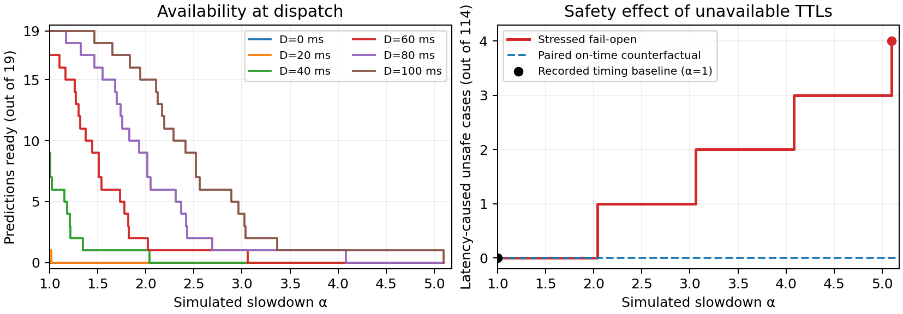

# Experiment B: computation-latency stress results

The [approved design](16_computation_latency_stress_proposal.md) is implemented
as a separate diagnostic. All nineteen feasible calibrated scenarios were
evaluated at D=0, 20, 40, 60, 80, and 100 ms, with T=4.2 s after approval.
Seed 16 remains infeasible and excluded.

**Fail-open execution becomes unsafe just above 2.039413× slowdown.** Further
slowdown exposes four unsafe scenario-delay pairs, all prevented by the same
stored prediction when available on time. The original measured timing baseline
has zero unsafe executions. These stress factors model prediction availability;
they are not measured performance on slower hardware.

## What was frozen and what changed

The nineteen TTL outputs and per-scenario computation times were copied from
the [executed short-delay supplement](15_short_delay_latency.md), with preserved
hashes. Its measured times were 42.52 ms mean, 41.48 ms median, and 61.18 ms p95,
with a 19.613–68.193 ms range. No prediction was rerun or retimed.

For every scenario, simulated prediction availability is `alpha * frozen_time`.
The same alpha applies to all nineteen scenarios. The existing native gate
remains `availability_time <= dispatch_delay`. Dispatch and mission deadlines
never move, and no delay is inserted into UAV physics or command execution.

The sweep includes all readiness transitions above the measured alpha=1
baseline, ending immediately after the final transition at approximately
5.098532×. It covers **65 readiness transitions and 131 evaluated alpha values**
(one recorded-timing baseline and 130 simulated stress values). Values at and
immediately after each transition cover every constant-readiness interval.

The paired **on-time counterfactual** uses the identical stored TTL, command,
dispatch step, initial conditions, and deadline. It changes only whether the
prediction is available for the existing gate at positive dispatch delays.
It is a diagnostic information-availability control, not a new operational
baseline or a ground-truth-based decision.

**D=0 retains immediate original-command dispatch in both arms.** No
zero-duration prediction is introduced. Thus nineteen D=0 predictions remain
unavailable even in the on-time counterfactual; its idealized availability
applies only to the 95 positive-delay cases.

## Recorded timing baseline versus simulated stress

Counts below are over **114 scenario-delay pairs**, reusing nineteen scenarios.
These are not 114 independent scenarios. Stress rows are the states immediately
after the indicated execution-changing thresholds; values are rounded for display.
Readiness continues changing between these rows, even when outcomes do not.

| Availability condition | Ready | Unavailable | Unsafe attributable to lateness | Safe mission completions | Operational false rejections |
|---|---:|---:|---:|---:|---:|
| Recorded timing, alpha=1 | 65 | 49 | 0 | 103 | 1 |
| Simulated, just above 1.019706× | 62 | 52 | 0 | 104 | 0 |
| Simulated, just above 2.039413× | 23 | 91 | 1 | 104 | 0 |
| Simulated, just above 3.059119× | 3 | 111 | 2 | 104 | 0 |
| Simulated, just above 4.078826× | 1 | 113 | 3 | 104 | 0 |
| Simulated, just above 5.098532× | 0 | 114 | 4 | 104 | 0 |
| Paired on-time counterfactual | 95 | 19 | 0 | 103 | 1 |

Every unavailable prediction executes the original command at its scheduled
dispatch step. Accordingly, the unavailable count also gives original-command
executions caused by unavailable TTLs. The measured baseline reproduces all
114 saved StaleGuard outcome and trace selections exactly.

The existing No Recovery baseline has four unsafe executions and 104 safe
completions on this grid. Always-Recover has zero unsafe executions and nineteen
safe completions. Their saved results are unchanged. At terminal stress,
StaleGuard selects the No Recovery trajectory in every case.



Only alpha=1 uses the recorded measured availability times directly. Every
alpha>1 point is simulated availability stress using frozen outputs and verified
flight trajectories. The paired counterfactual remains safe throughout.
The [PDF figure](../result/computation_latency_stress.pdf) is also available.

## Exact execution-changing thresholds

Only seed 10's stored TTL rejects commands in this short-delay range. This was
determined after evaluating all nineteen scenarios; the sweep was not restricted
to seed 10. Other scenarios contribute the remaining availability transitions,
but their allowing TTL decisions leave their execution unchanged.

Seed 10's frozen measured prediction time is **19.613488 ms**. Its prediction
is `INVALID_AT_APPROVAL`, which rejects all dispatch delays when available.

| D | Approximate critical alpha | Result immediately after prediction becomes late | Original first unsafe entry |
|---:|---:|---|---:|
| 20 ms | 1.019706 | Safe command executes; false rejection and completion harm disappear | None through deadline |
| 40 ms | 2.039413 | Original command executes unsafely; paired on-time rejection remains safe | 1.929 s |
| 60 ms | 3.059119 | A second unsafe pair is exposed | 1.929 s |
| 80 ms | 4.078826 | A third unsafe pair is exposed | 1.934 s |
| 100 ms | 5.098532 | A fourth unsafe pair is exposed | 1.945 s |

Entry times are from mission start. The four unsafe pairs are different delays
of the same scenario, not four independent scenario failures. Maximum stress
exposure is 4/114 pairs (3.51%), or 1/19 scenarios.

The mathematical boundary is `alpha = D / frozen_time`; readiness includes
equality. Floating division and multiplication can round differently, so the
implementation finds the last representable alpha for which the native product
is ready and the adjacent first late value. It does not round the product or
add a tolerance. Full-precision boundaries are in the JSON results. Native
execution validates both sides; the displayed rounded factors are approximate.

## Attribution and false-rejection consequences

A case is attributed to latency only if the prediction is unavailable, its
stored TTL would reject, stressed execution is unsafe, and the paired on-time
execution is safe. Actual entry must occur after dispatch. All four exposed
unsafe pairs meet these conditions: their original-command and dispatch-time
fallback trajectories were both previously executed and verified.

The sweep separately counts unsafe executions with an allowing TTL and unsafe
executions despite on-time rejection. Both counts are zero on this matrix.
Lateness alone is never used as evidence that a prediction was correct.

Seed 10's rejecting decision is correct for D=40–100 ms, but it also rejects
the operationally safe D=20 ms command. Therefore its TTL is not globally
accurate simply because four rejecting decisions are correct.

At recorded timing, the D=20 ms prediction is ready and prevents a safe
completion. Once alpha exceeds approximately 1.019706, fail-open dispatch
executes that safe command and restores one safe completion. This explains
the increase from 103 to 104 safe completions. The four later unsafe executions
are never counted as safe completions. Completion count alone would therefore
hide the deterioration in safety.

## Trajectory reuse and actual execution checks

The diagnostic uses 114 saved No Recovery trajectories and five saved
StaleGuard dispatch-time fallback trajectories from the earlier 342-flight
supplement. These **119 previously executed trajectory records** cover both
arms of every pair. For an allowing TTL, the on-time counterfactual is the same
original-command trajectory. For a rejecting positive-delay TTL, the paired
fallback was actually executed at the same dispatch step. No missing trajectory
had to be inferred or simulated.

The complete sweep is derived by selecting these verified trajectories through
the unchanged gate. It is not 131 independent PyBullet reruns or a fresh
hardware benchmark.

**29 new native PyBullet validation flights were executed serially:**

- Before, at, and after every execution-changing threshold: fifteen flights.
- Before, at, and after one availability-only transition per eligible delay,
  choosing the lowest eligible seed: twelve flights.
- Terminal-stress D=0 execution with an ordinary TTL and a rejecting TTL:
  two flights.

All 29 complete control/reference and 1,000 Hz physics-position trace hashes
matched their selected original or fallback reference. The TTL was consulted
exactly once at dispatch when ready and never consulted when unavailable.
Command references verified unchanged dispatch timing. Whole-flight matches to
No Recovery exclude cancellation after a late result arrives. All four unsafe
transitions were reproduced, alongside the safe D=20 ms false-rejection change.

The existing 2,048 MiB maximum process RSS, 2,048 MiB minimum available host
memory, one-worker validation lock, and numerical-library thread limits were
retained. The recorded validation-worker peak was 701.57 MiB. No guard stop
occurred. All recorded scientific-source, calibration, frozen-input, and prior
result hashes remained unchanged. Four existing temporal safety tests passed.

## Scope and limitations

Uniform scaling is a controlled model of slower result availability, not a
measurement of slower CPUs, contention, scheduler jitter, or onboard timing.
Predictions and their ranking by runtime remain fixed. The original timings
were one warm measurement per scenario, excluding JIT compilation and snapshot
acquisition as in official B. Adjacent-float transition checks verify the decision
boundary; they do not claim physically measurable timing precision.

The systematic sweep covers this fixed short-delay grid and deterministic
scenario set. It establishes conditional failure thresholds, not deployment
failure probabilities. The wider experiment's model errors at seeds 7/8,
D=0.4 s, remain outside this range and are unchanged. No dynamics-model tuning,
safety margin, alternate fallback, or fail-closed policy was introduced.

The predictor still uses its original 0.0–1.0 s delay grid and horizon ending
8.5 s from mission start. Operational outcomes retain the 4.2 s deadline after
approval (absolute 4.20–4.78 s), with unchanged 1,000 Hz safety monitoring. This
is an operational latency study, not a new fine-grid TTL-accuracy evaluation.

## Evidence and reproduction

- [Supplementary diagnostic source](../diagnostics/computation_latency_stress.py)
- [Full sweep, frozen measurements, thresholds, and validation metadata](../result/computation_latency_stress.json)
- [Actual boundary flight records](../results/computation_latency_stress/boundary_executions.jsonl)
- [Boundary-validation progress](../results/computation_latency_stress/validation_progress.log)
- [Input and prior-result preservation hashes](../results/computation_latency_stress/preserved_files.json)

Run from `examples/staleguard` in the existing `scg` environment:

```sh
python inspection_descent/diagnostics/computation_latency_stress.py --stage analyse
python inspection_descent/diagnostics/computation_latency_stress.py --stage validate
python inspection_descent/diagnostics/computation_latency_stress.py --stage plot
```

Analysis freezes the saved prediction/trajectory files once and never replaces
them. Validation resumes its checkpoint without repeating completed flights;
a completed-checkpoint audit added no further simulations. Analysis and plotting
do not invoke the predictor or step PyBullet. Existing results are preserved.
