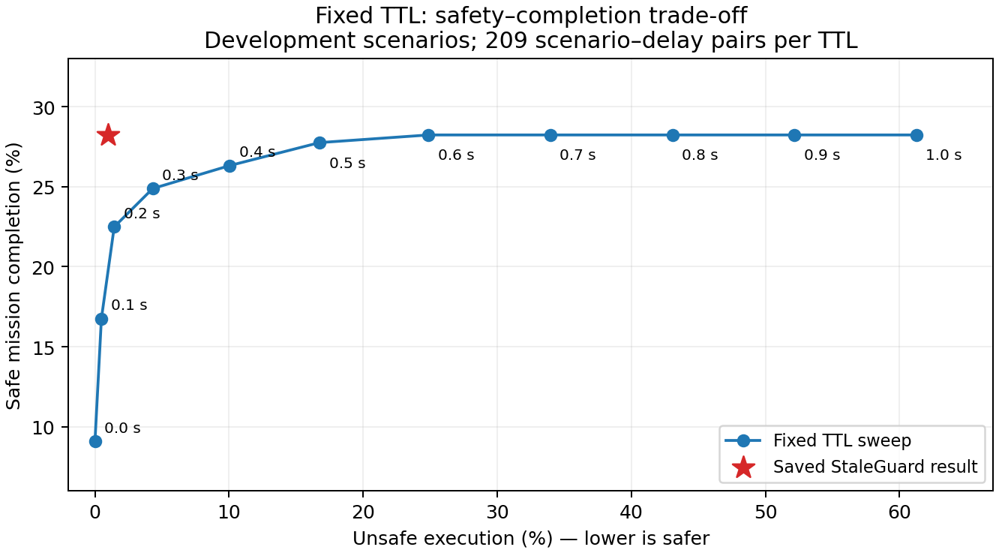

# Experiment B: Fixed TTL development sweep — 22 October 2026

All eleven prespecified TTLs, **0.0–1.0 s in 0.1 s steps**, were evaluated on
the existing 19 feasible development scenarios and eleven dispatch delays.
Each TTL has **209 scenario–delay pairs**; the complete sweep has **2,299**.
Seed 16 remains infeasible and excluded. No TTL was selected, and no
independent final-test scenarios were executed.

## Implementation

`staleguard_benefit.py` accepts an optional fixed lifetime in control steps.
The same configured lifetime is attached to every command at approval. At
scheduled dispatch, the native executor uses:

```python
expired = waited_steps > ttl_steps
```

Equality permits the original descent. An expired command is cancelled and
the existing safety-only fallback starts at that dispatch step. In particular,
TTL=0 permits D=0 and cancels at every positive tested delay. Nothing is
cancelled before dispatch merely because the TTL has elapsed.

The static TTL requires no asynchronous prediction or readiness rule. The
dispatch comparison uses integer steps on the existing 50 Hz control grid,
avoiding floating-point equality changes such as 0.6 versus 0.6000000001.
It does not use state features, dynamics models, future-state information or
knowledge of D when assigning the lifetime. There is no command postponement.

The original command, PID, PyBullet physics, 1,000 Hz unsafe-entry monitor,
inspection objective and safety-only fallback are unchanged. Every flight
keeps its original deadline of approval + 4.2 s. These operational outcomes
are distinct from TTL ground truth's 8.5 s observation horizon from mission
start; this sweep neither changes nor reruns that accuracy evaluation.

The new CLI flag adds Fixed TTL to the requested existing policy set:

```sh
python inspection_descent/staleguard_benefit.py --count 20 --experiment B --fixed-ttl 0.5

# Include all five existing policies as well, if running a fresh comparison.
python inspection_descent/staleguard_benefit.py --count 20 --experiment B --fbs --fixed-ttl 0.5
```

The value 0.5 here is an invocation example, not a selected operating point.
Without `--fixed-ttl`, existing configurations remain unchanged.

## Complete sweep results

All percentages use N=209. Mission categories are mutually exclusive.

| Fixed TTL (s) | Unsafe executions | Safe completion | Safe non-completion | Fallback count |
|---:|---:|---:|---:|---:|
| 0.0 | 0 (0.00%) | 19 (9.09%) | 190 (90.91%) | 190 |
| 0.1 | 1 (0.48%) | 35 (16.75%) | 173 (82.78%) | 171 |
| 0.2 | 3 (1.44%) | 47 (22.49%) | 159 (76.08%) | 152 |
| 0.3 | 9 (4.31%) | 52 (24.88%) | 148 (70.81%) | 133 |
| 0.4 | 21 (10.05%) | 55 (26.32%) | 133 (63.64%) | 114 |
| 0.5 | 35 (16.75%) | 58 (27.75%) | 116 (55.50%) | 95 |
| 0.6 | 52 (24.88%) | 59 (28.23%) | 98 (46.89%) | 76 |
| 0.7 | 71 (33.97%) | 59 (28.23%) | 79 (37.80%) | 57 |
| 0.8 | 90 (43.06%) | 59 (28.23%) | 60 (28.71%) | 38 |
| 0.9 | 109 (52.15%) | 59 (28.23%) | 41 (19.62%) | 19 |
| 1.0 | 128 (61.24%) | 59 (28.23%) | 22 (10.53%) | 0 |

The fixed TTL grid was recorded before evaluation. No threshold was added,
interpolated, optimized or chosen using StaleGuard outcomes. The saved
StaleGuard reference is **2 unsafe, 59 safe completions, 148 safe
non-completions and 127 fallbacks** out of 209.

## Safety–completion trade-off



Each point is one evaluated TTL, labeled in seconds. Connecting lines guide
the eye; intermediate TTL values were not evaluated. Lower unsafe execution
and higher safe completion are preferable. The star is the saved StaleGuard
result, added as a reference after computing the complete fixed sweep.
[PDF figure](../result/fixed_ttl_tradeoff.pdf).

## Interpretation

Longer TTLs admit more delayed descents, increasing completion and unsafe entry.
Safe completions reach 59/209 at TTL=0.6 s and then remain constant, while
unsafe executions increase from 52 to 128 over TTL=0.6–1.0 s.
TTL=0.1 s yields 1 unsafe execution and 35 safe completions; the saved
StaleGuard result has 2 unsafe executions and 59 safe completions.
No evaluated constant TTL matches both StaleGuard's completion count and its
unsafe count or lower. These are descriptive development-set observations.
The sweep does not select a single TTL or establish final-test generalization.

## Trajectory reuse and actual validation

The sweep reuses verified trajectories from the corrected Experiment B
four-policy evaluation. Accepted commands use the matching No Recovery
execution. Expired commands use the matching safety-only Always-Recover
physical trajectory. The cached fallback begins earlier, at approval, but
its reference is the same nominal forward path at usual altitude both before
and after cancellation. Withholding the pending descent until dispatch and
then cancelling it therefore produces the same state/reference trajectory.
The cached early cancellation is **not** treated as evidence of the new
policy's decision time; that timing is validated separately below.

**34 actual native PyBullet flights** verified the new policy. For the lowest
eligible seed, each TTL was checked at the adjacent development-grid delay
before, exactly at and after expiration where those delays remain in 0–1 s.
The lowest eligible seed with positive approval time was additionally checked
at TTL=0.5 s and D=0.4/0.5/0.6 s. Thus the selected timing cases are seeds
0 and 2, chosen without examining unsafe or completion outcomes.

All **23 accepted executions** and **11 fallback executions** matched their
reference's full control and 1,000 Hz physics trace hashes exactly. Assertions
checked that the expiration function runs once at scheduled dispatch, its
age is relative to the correct approval, command application/fallback occurs
at that step, the pre-dispatch prefix is unchanged, and the original deadline
is retained. Unit executions also test the immediately adjacent 20 ms control
steps around expiration, including TTL=0.

The native main/report integration was exercised for every TTL with all six
policies, using cached outcomes to avoid extra flights. Fixed TTL metrics
matched the sweep and all five prior policies matched their saved metrics.
This was an aggregation/integration check, not 11 fresh six-policy experiments.

**19 unit tests passed**, including four new Fixed TTL tests. The entire prior
executor's AST remains identical after removing the two new optional arguments
and their guarded branches. Preservation hashes cover the existing scientific
sources, calibration, cached inputs and saved results; only the authorized
executor edit is exempted. No old result was overwritten.

Execution was CPU-only, headless and serial, with the existing validation lock,
one library thread, 2 GiB maximum worker RSS and 2 GiB minimum host-available
memory. Maximum recorded worker RSS was **635 MiB** and minimum available
host memory was **2,912 MiB**; no memory guard stopped validation.

## Reproduction and evidence

From `examples/staleguard`, in the existing `scg` environment:

```sh
# Full development sweep from verified trajectories.
python inspection_descent/diagnostics/fixed_ttl_sweep.py --stage analyse

# Serial, memory-guarded actual dispatch/fallback boundary executions.
python inspection_descent/diagnostics/fixed_ttl_sweep.py --stage validate

# Refresh summary with completed validation and export the curve.
python inspection_descent/diagnostics/fixed_ttl_sweep.py --stage analyse
python inspection_descent/diagnostics/fixed_ttl_sweep.py --stage plot

python -m unittest discover -s inspection_descent/diagnostics -p 'test*.py' -v
```

- [Sweep metrics and per-delay breakdowns](../result/fixed_ttl_sweep.json)
- [CSV table](../result/fixed_ttl_sweep.csv)
- [Terminal table](../result/fixed_ttl_sweep.log)
- [2,299 reused outcome records](../results/fixed_ttl/sweep_executions.jsonl)
- [34 actual boundary executions](../results/fixed_ttl/boundary_executions.jsonl)
- [Validation summary](../results/fixed_ttl/validation.json)
- [Native main/report integration checks](../results/fixed_ttl/main_integration_checks.json)
- [Unit-test output](../results/fixed_ttl/unit_tests.log)

Limits: only the existing 19 development scenes are evaluated, and their
eleven delays are paired observations rather than independent scenes.
Trajectory reuse assumes the unchanged deterministic simulator and nominal
safety-only fallback, supported by representative full-trace checks rather
than rerunning all 2,299 combinations. No uncertainty claim or independent
final-test conclusion is made.
