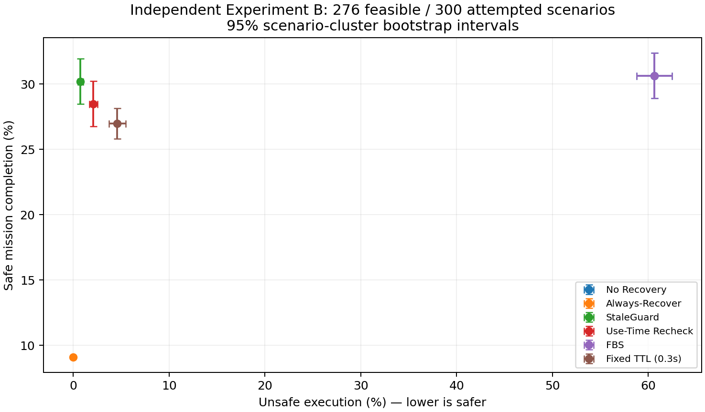

# Independent Experiment B: final six-policy results

## Main finding

StaleGuard reduced unsafe executions from **1,841 to 22** relative to No Recovery, while retaining **917 of 930 safe mission completions**. It achieved both fewer unsafe executions and more safe completions than Use-Time Recheck and Fixed TTL (0.3 s). Always-Recover had zero observed unsafe entries but substantially fewer completions. The locked UAV adaptation of FBS never expired within the tested dispatch delays and matched No Recovery.

This report documents the completed independent evaluation, its implementation, measured results, paired analysis and reconstructed execution time. It introduces no algorithm changes, parameter selection or additional simulations. Results were completed on **2026-10-22 at 18:44:59 UTC (20:44:59 Europe/Paris)**. Seeds 0–19 remain development data and are not pooled into these results.

## 1. Scope and frozen protocol

| Item | Configuration |
|---|---|
| Attempted independent scenarios | Exactly 300: seeds 20–319 inclusive |
| Calibration | Existing D=0 maximum continuous inspection dwell; original candidate grid/order; first candidate on ties; no positive-delay outcomes |
| Feasibility | Safe D=0 execution with at least 180 ms continuous inspection dwell |
| Feasible scenarios evaluated | 276; 24 infeasible scenarios were not replaced |
| Dispatch delays | 0.0, 0.1, …, 1.0 s; unknown at StaleGuard reception |
| Mission deadline | Approval time + 4.2 s for every policy |
| Control / physics / lightweight integration | 50 Hz / 1,000 Hz / 100 Hz |
| Actual safety monitoring | Existing closed unsafe-volume predicate at every 1 ms physics sample |
| Predicted safety monitoring | Existing swept straight segments between predicted control positions, 20 ms apart |
| Inspection objective | Continuous dwell ≥180 ms, with existing position/altitude tolerances |
| Recovery | Existing safety-only fallback; nominal forward flight at usual altitude; no inspection retry |
| Resources | CPU-only, headless, one simulator worker, one numerical-library thread |
| Outcome denominators | 276 per delay; 3,036 scenario–delay pairs per policy; 18,216 results across six policies |

Scenario distributions were unchanged: speed 0.4–0.8 m/s; usual height 1.15–1.40 m; structure start 0.8–1.5 m; length 0.3–0.6 m; lateral unsafe half-width 0.35 m; unsafe altitude threshold 0.90–1.05 m. Requested descent height and initial command duration retain the existing generator distributions. Calibration can change approval time and low-altitude duration using the original finite grid; it does not change the generated geometry, speed or altitude targets.

Calibration maximizes the longest continuous inspection dwell among candidates with no D=0 unsafe entry. This avoids selecting commands that barely meet the inspection requirement and provides a possible timing buffer. It does not optimize delayed success, certify a delay budget, or guarantee safety after delayed dispatch.

### Observation horizon versus mission deadline

The shared prediction/reference observation horizon is **8.5 s from flight start**, not 4.2 s after approval. StaleGuard predicts through the remaining horizon; Use-Time Recheck uses the remaining horizon from its dispatch snapshot. Operational mission outcomes are monitored only until the original deadline, **approval + 4.2 s**, unless execution terminates earlier. Selected approval times range from 0 to 1.56 s, so these operational deadlines range from 4.2 to 5.76 s from flight start. FBS's 4.2 s maximum TTL is a third quantity: a cap on approval lifetime. These quantities must not be treated as interchangeable. This report does not rerun TTL ground-truth accuracy evaluation or diagnose whether any particular rejection comes from the longer prediction horizon.

## 2. Policy semantics

| Policy | Decision and computation semantics |
|---|---|
| No Recovery | Execute the original calibrated descent at scheduled dispatch; no fallback. |
| Always-Recover | At positive dispatch delay, activate the existing fallback at approval. At D=0, the existing strict-before-dispatch rule permits the original command. |
| StaleGuard | Predict the TTL once from approval state/PID/reference, without actual dispatch-delay input. At scheduled dispatch, fall back at or beyond the first predicted unsafe grid delay. If computation is unavailable, execute on schedule; no later cancellation. |
| Use-Time Recheck | Capture current state/PID/reference at scheduled dispatch; withhold descent; perform one immediate-execution model rollout. Continue nominal simulated flight during the measured computation interval. Apply SAFE/descent or UNSAFE/fallback at the first control step strictly after completion; do not revalidate. |
| FBS | Observe signed geometric clearance at 50 Hz through approval; EMA coefficient 0.1, initial volatility zero. Freeze floor(min(210, max(margin,0)/max(volatility,1e-12))) control steps. Expire when age exceeds TTL (or margin is nonpositive); fail open if unavailable. |
| Fixed TTL (0.3 s) | Assign 15 control steps at approval. Execute when age ≤15 steps; otherwise activate fallback at scheduled dispatch. No predictive computation or postponement. |

FBS clearance is `max(x_min-x, x-x_max, abs(y)-y_limit, z-unsafe_below_z)`. Volatility is `0.1*abs(f[t]-f[t-1]) + 0.9*v[t-1]`. Epsilon remains the preregistered **1e-12 metres per control sample numerical floor**, not a physical noise estimate. Neither epsilon nor Fixed TTL was selected from independent outcomes. Use-Time Recheck is an adaptation inspired by verification before commitment, not a complete Gatekeeper implementation or transfer of its formal guarantees.

## 3. Code changes and implementation provenance

The independent evaluation added orchestration and reporting around the existing scientific implementations. The corrected predictor, calibration objective, scenario generator, PID, physics, safety predicates, mission and existing policy decisions were reused. The Fixed TTL branch had already been introduced for the development sweep; the independent runner uses its locked 0.3 s value.

| File | Change / responsibility |
|---|---|
| [independent_evaluation.py](../../independent_evaluation.py) | New serial seeds-20–319 driver; calls the official calibration planner; saves candidate/flight checkpoints, approval snapshots and measured reception predictions; validates timing and reference reuse; launches reporting after completion. |
| [independent_report.py](../../independent_report.py) | New six-policy/per-delay report, aggregate outcomes, paired comparisons, scenario-cluster confidence intervals, computation summaries and trade-off figure. |
| [launch_independent_evaluation.sh](../../launch_independent_evaluation.sh) | New detached `nohup`/`setsid` supervisor; `systemd-inhibit` encloses the full job; duplicate-run checks, resume and success/failure lifecycle. |
| [test_independent_evaluation.py](../../diagnostics/test_independent_evaluation.py) | Tests streamed dwell, durable journals/resume, unchanged first-on-tie calibration/infeasibility, cluster statistics, paired tests and six-policy report schema. |
| [staleguard_benefit.py](../../staleguard_benefit.py) | Existing common execution utility; development-stage additions provide Fixed TTL validation, dispatch expiration, event logging, optional policy execution and reporting. The independent stage imports `run_actual` and the existing predictor/policy utilities. |
| [max_dwell_calibration.py](../../max_dwell_calibration.py) | Existing scientific planner reused directly. The driver substitutes a constant-memory physics summary and replays completed candidate outcomes without changing candidate selection. |
| [staleguard.py](../../staleguard.py), [use_time_recheck.py](../../use_time_recheck.py), [fbs.py](../../fbs.py), [experiment.py](../../experiment.py) | Existing scientific algorithms and definitions reused; no independent-test parameter tuning. |
| [implementation documentation](../../docs/22_independent_six_policy_evaluation.md) | Frozen protocol, checkpoint/reuse rationale, statistical method and launch/resource instructions. |

The scientific source files and development artifacts were frozen in [preserved_files.json](preserved_files.json). All **56 recorded SHA-256 checks still match** at report preparation. Git HEAD is `553777b` (FBS baseline); the independent runner/report/launcher/tests and earlier Fixed TTL additions are working-tree changes, not all represented by that commit. Use the recorded hashes to identify the evaluated source state, rather than treating HEAD alone as sufficient provenance. This packaging task changed no scientific source file.

### Checkpointing, reuse and resources

All 300 calibration attempts finish before full evaluation. Seeds 20 and 21 were calibrated and evaluated at D=0, 0.3 and 0.4 s for the required prelaunch smoke test; those records remain in the final cohort. Resume consumes completed calibration candidates and skips saved policy–delay results. Each committed journal record is flushed/fsynced, and final JSON writes use atomic replacement.

No Recovery, StaleGuard, Use-Time Recheck and FBS run natively at every delay. Always-Recover reuses the same scenario's immediate-original result at D=0 and a native nominal fallback trajectory for positive delays. Fixed TTL reuses either that delay's original trajectory or the same scenario's nominal fallback; D=0.3 and 0.4 are additionally executed natively for every feasible scenario and checked against reference outcome/control/physics hashes.

There are **12,980 actual native PyBullet policy flights and 5,236 reused policy records**, totaling 18,216 results. The native count is 47×276 plus 8 extra native smoke flights. Calibration adds **37,575 D=0 candidate execution trials**; approval-snapshot prefix simulations and warmups are additional simulator work, so these counts must not be described as the complete count of all simulator invocations. Reuse records identify their source and are not predictions or interpolated physical trajectories.

The 2 GiB process-RSS and 2 GiB minimum-available-host-memory checks were retained. Streaming dwell/state hashes avoid storing full trajectories in memory; resources are released between simulations. These are sampled guards, not an operating-system-enforced memory cap. One initial preflight failed the memory guard before the successful smoke/launch; its failure was retained. Final status is SUCCESS, and the main-run log contains no failure traceback.

### Validation evidence

The saved unit-test log records **26 passing tests**. The new-scene smoke test records **36 native policy flights**, successful calibration/flight interruption-and-resume checks, idempotent completed-work resume and development-artifact preservation. During the full run, assertions check the dispatch/approval snapshot, prediction readiness, application step, unchanged command duration, FBS observation alignment and Fixed TTL boundary trajectory equivalence.

During report preparation, a read-only audit checked all **18,216 merged records** against the 276 per-seed journals, all aggregate counts against the summary, each seed's 66 unique policy–delay keys, and all **5,236 reuse reference hashes/outcomes**. No simulations or tests were rerun for this documentation task. Original validation logs are retained in `../run_metadata/` and per-seed checkpoints in `../scenario_checkpoints/`, outside this core-results package.

## 4. Calibration feasibility

**276/300 scenarios were feasible: 92.00%, Wilson 95% CI [88.37%, 94.57%].** There were 37,575 candidate trials. The 24 infeasible seeds were:

`37, 41, 43, 59, 63, 64, 66, 80, 87, 98, 105, 106, 108, 118, 141, 175, 191, 192, 200, 229, 248, 275, 287, 299`

No infeasible scenario was replaced. Operational outcome intervals below condition on this feasible population. D=0 safe completion is guaranteed by the selection criterion for immediate execution; its 100% result is a calibration property, not an independent discovery about robustness to delay.

## 5. Aggregate outcomes

Each row covers 3,036 scenario–delay pairs. Unsafe entry takes precedence over completion: a flight that inspects successfully but later enters the unsafe region is counted as unsafe, not a safe completion. Safe non-completion means no unsafe entry but no completed inspection by the unchanged deadline.

| Policy | Unsafe | Safe completion | Safe non-completion | Fallback triggered |
|---|---:|---:|---:|---:|
| No Recovery | 1,841 (60.64%) | 930 (30.63%) | 265 (8.73%) | 0 (0.00%) |
| Always-Recover | 0 (0.00%) | 276 (9.09%) | 2,760 (90.91%) | 2,760 (90.91%) |
| StaleGuard | 22 (0.72%) | 917 (30.20%) | 2,097 (69.07%) | 1,855 (61.10%) |
| Use-Time Recheck | 63 (2.08%) | 864 (28.46%) | 2,109 (69.47%) | 1,844 (60.74%) |
| FBS | 1,841 (60.64%) | 930 (30.63%) | 265 (8.73%) | 0 (0.00%) |
| Fixed TTL (0.3s) | 139 (4.58%) | 819 (26.98%) | 2,078 (68.45%) | 1,932 (63.64%) |

Every triggered fallback was safe in the observed executions: Always-Recover 2,760/2,760, StaleGuard 1,855/1,855, Use-Time Recheck 1,844/1,844 and Fixed TTL 1,932/1,932. No Recovery/FBS triggered none, so their fallback safety is undefined rather than 0%.

| Policy | Unsafe-rate 95% CI (%) | Safe-completion-rate 95% CI (%) |
|---|---:|---:|
| No Recovery | [58.79, 62.48] | [28.92, 32.38] |
| Always-Recover | [0.00, 0.00] | [9.09, 9.09] |
| StaleGuard | [0.46, 1.02] | [28.49, 31.95] |
| Use-Time Recheck | [1.65, 2.54] | [26.74, 30.24] |
| FBS | [58.79, 62.48] | [28.92, 32.38] |
| Fixed TTL (0.3s) | [3.72, 5.47] | [25.82, 28.13] |

These are scenario-cluster percentile intervals. Always-Recover's zero-event bootstrap interval is degenerate and does not certify zero risk. Its complementary scenario-level probability-of-any-unsafe Wilson interval is **[0%, 1.37%]**. StaleGuard had at least one unsafe tested delay in **22/276 scenarios (7.97%; Wilson CI [5.32%, 11.77%])**; Use-Time Recheck in **63/276 (22.83%)**. These scenario-level figures are different quantities from the aggregate pair-level unsafe rates.

## 6. Outcomes by dispatch delay

Each cell is **unsafe executions / safe mission completions**, out of 276 scenarios. The remaining count is safe non-completion. Full counts, fallbacks and intervals are in [per_delay.csv](per_delay.csv).

| D (s) | No Recovery | Always-Recover | StaleGuard | Use-Time Recheck | FBS | Fixed TTL (0.3 s) |
|---|---:|---:|---:|---:|---:|---:|
| 0.0 | 0 / 276 | 0 / 276 | 0 / 276 | 1 / 271 | 0 / 276 | 0 / 276 |
| 0.1 | 10 / 242 | 0 / 0 | 1 / 240 | 4 / 230 | 10 / 242 | 10 / 242 |
| 0.2 | 39 / 178 | 0 / 0 | 3 / 175 | 17 / 164 | 39 / 178 | 39 / 178 |
| 0.3 | 90 / 123 | 0 / 0 | 5 / 118 | 13 / 103 | 90 / 123 | 90 / 123 |
| 0.4 | 159 / 66 | 0 / 0 | 5 / 65 | 17 / 58 | 159 / 66 | 0 / 0 |
| 0.5 | 213 / 31 | 0 / 0 | 3 / 30 | 5 / 26 | 213 / 31 | 0 / 0 |
| 0.6 | 240 / 12 | 0 / 0 | 3 / 12 | 3 / 11 | 240 / 12 | 0 / 0 |
| 0.7 | 264 / 2 | 0 / 0 | 2 / 1 | 2 / 1 | 264 / 2 | 0 / 0 |
| 0.8 | 274 / 0 | 0 / 0 | 0 / 0 | 1 / 0 | 274 / 0 | 0 / 0 |
| 0.9 | 276 / 0 | 0 / 0 | 0 / 0 | 0 / 0 | 276 / 0 | 0 / 0 |
| 1.0 | 276 / 0 | 0 / 0 | 0 / 0 | 0 / 0 | 276 / 0 | 0 / 0 |

No Recovery becomes unsafe for every feasible scenario at D=0.9 and 1.0 s. StaleGuard eliminates unsafe entries at D≥0.8 s, but no policy achieves a safe completion there. Thus safe non-completion at large delays largely reflects inspection opportunities already missed by the forward-moving UAV; safe fallback cannot recover a missed mission under this safety-only design. Fixed TTL eliminates unsafe entries after 0.3 s by rejecting every original command, including potentially completable ones.

The aggregate gives equal weight to all eleven prescribed delays, including calibrated D=0 and large delays where completion is impossible. It is not an estimate under an observed real-world dispatch-delay distribution. Excluding D=0 descriptively, StaleGuard has 22/2,760 unsafe pairs and 641/2,760 safe completions; No Recovery has 1,841 and 654 respectively. This is a descriptive slice, not a replacement analysis or a change to the locked protocol.

## 7. Paired StaleGuard comparisons

Differences below are **StaleGuard minus baseline**, in percentage points. Lower unsafe and higher safe completion are favorable. Confidence intervals resample entire scenarios (10,000 replicates, seed 1729), retaining all eleven delays and all policies together. Tests are exact scenario-level paired sign tests; Holm adjustment covers all 180 aggregate/per-delay comparisons. The sign test assesses the direction of per-scenario differences; the bootstrap CI estimates the mean rate difference, so they need not always yield identical significance decisions.

| Baseline | Metric | Difference (pp) | 95% CI (pp) | Holm-adjusted p |
|---|---|---:|---:|---:|
| No Recovery | unsafe | -59.91 | [-61.79, -58.04] | 2.96e-81 |
| No Recovery | safe completion | -0.43 | [-0.66, -0.20] | 0.0273 |
| Always-Recover | unsafe | +0.72 | [+0.46, +1.02] | 5.48e-05 |
| Always-Recover | safe completion | +21.11 | [+19.40, +22.86] | 1.79e-70 |
| Use-Time Recheck | unsafe | -1.35 | [-1.88, -0.82] | 0.000119 |
| Use-Time Recheck | safe completion | +1.75 | [+1.28, +2.21] | 6.02e-11 |
| FBS | unsafe | -59.91 | [-61.79, -58.04] | 2.96e-81 |
| FBS | safe completion | -0.43 | [-0.66, -0.20] | 0.0273 |
| Fixed TTL (0.3s) | unsafe | -3.85 | [-4.78, -2.93] | 5.1e-12 |
| Fixed TTL (0.3s) | safe completion | +3.23 | [+2.34, +4.15] | 6.08e-09 |

StaleGuard outperforms Use-Time Recheck and Fixed TTL on both reported objectives in aggregate, with paired intervals excluding zero. It exchanges a small but measurable loss of completion for a very large safety improvement over No Recovery/FBS. Always-Recover remains safer in the observed sample but completes far fewer missions. These results do not identify a universally optimal policy or a newly optimal Fixed TTL.

## 8. Mechanisms supported by saved executions

### StaleGuard: protection and false rejection

Relative to paired No Recovery, StaleGuard prevented **1,819/1,841 unsafe executions (98.80%)**, retaining **917/930 safe completions (98.60%)**. Its 1,855 fallbacks include 1,819 originally unsafe commands and 36 originally safe commands. Of those 36 safe commands, 13 would have completed the mission and 23 would not. This separates false rejection of safe execution from its narrower consequence of losing a safe mission completion.

All **22 StaleGuard unsafe cases** had a prediction ready at dispatch and an explicit SAFE entry at that tested delay. None was attributable to unavailable prediction computation on this grid. Each occurred in a different scenario. The saved records establish a false-safe prediction; they do not establish the precise dynamical/geometric root cause of each error. No claim is made that all 22 have the same cause as development seeds 7 and 8. Their seed/delay identifiers and the 13 lost completions are recorded in [analysis_metrics.json](analysis_metrics.json) for audit without including full diagnostic traces here.

### Use-Time Recheck: movement during computation

Use-Time Recheck produced 63 unsafe executions following SAFE predictions. In **41**, the same scenario's original command was safe when applied at scheduled dispatch (paired No Recovery), while delayed application was unsafe. These are observed adverse consequences of delaying use while the UAV moves. In the other 22, immediate execution was already unsafe, establishing that the immediate safety prediction was also false-safe. This decomposition does not quantify the separate contributions of numerical model error versus within-step geometric error.

The check-to-use delay was exactly 20 ms in every case under the 50 Hz application rule. Recheck prediction uses the dispatch snapshot and is not refreshed when the command is applied. It therefore cannot be assumed safer merely because its initial information is newer. The two methods' unsafe sets overlap in only seven scenario–delay pairs: StaleGuard is unsafe/Recheck safe in 15, and Recheck unsafe/StaleGuard safe in 56. StaleGuard-only safe completions number 57, versus four Recheck-only safe completions. The development-set safety ordering did not generalize to this independent cohort.

### Fixed TTL: a uniform lifetime misses scenario-specific timing

Fixed TTL permits every original command through D=0.3 s, producing 139 unsafe entries, and rejects all commands at D≥0.4 s. Relative to it, StaleGuard yields **117 fewer unsafe executions and 98 more safe completions**. This supports adaptive timing on this cohort, while leaving the fixed baseline and its preselected lifetime unchanged. No alternative TTL is selected using these independent outcomes.

### FBS: no expiration in the tested delay range

The frozen FBS TTL ranged from **1.26 to 4.20 s**; **242/276** scenarios reached the 4.2 s cap. All TTLs exceed the maximum 1.0 s tested dispatch delay. Therefore it never triggers fallback and exactly matches No Recovery. There are **58 cold-start scenarios** with no pre-approval observation history beyond the approval sample; initial volatility is zero by design.

The chosen feature describes current geometric clearance, while the command later changes altitude as forward motion continues. Low historical feature volatility and large current clearance can therefore coexist with an unsafe delayed descent. This is a limitation of this locked, model-free UAV adaptation in these scenarios, not a general refutation of the published FBS method. No post-test epsilon or feature adjustment was made.

## 9. Prediction computation and dispatch timing

| Policy | Timed predictions | Mean (ms) | Median (ms) | p95 (ms) | Maximum (ms) |
|---|---:|---:|---:|---:|---:|
| StaleGuard | 276 | 43.0132 | 42.2555 | 61.3880 | 69.3321 |
| Use-Time Recheck | 3036 | 3.5870 | 1.4841 | 7.6032 | 10.1165 |
| FBS | 3036 | 0.0092 | 0.0081 | 0.0139 | 0.0390 |

StaleGuard's 276 approval-time sweeps are measured once per scenario and reused across delays. Recheck has one immediate rollout per scenario–delay pair. FBS approval calculations are timed in each native policy execution; earlier 50 Hz observation updates are recorded separately in [computation_times.json](computation_times.json). These timings cover different computational tasks, so a faster individual Recheck is not a faster TTL sweep.

- **StaleGuard:** 0/276 ready at D=0; 276/276 ready at each D≥0.1 s. Its maximum 69.33 ms is below the first positive-delay dispatch at 100 ms. The coarse independent grid therefore does not stress unavailable predictions on unsafe commands.
- **FBS:** also unavailable at zero-age dispatch and available at all positive delays. Its failure here is TTL validity, not slow computation.
- **Use-Time Recheck:** result applied successfully in all 3,036 cases at the first post-computation control step. All measured checks were shorter than 20 ms, so every decision/application delay is 20 ms. This readiness is at delayed application, not readiness at the scheduled dispatch instant; it must not be equated with StaleGuard's readiness statistic.

Measured wall-clock computation is mapped into simulated control time. Physics/PID nominal evolution is advanced serially through that duration; this is not an actual concurrent onboard controller or a real-time operating-system scheduling measurement. CPU load, hardware and instrumentation can influence these runtimes.

## 10. Total execution time: reconstructed, not instrumented

The runner did **not** persist monotonic start/end timers for calibration and evaluation. Exact phase CPU times and exact simulator-only durations are unavailable. The following elapsed wall-clock windows are reconstructed from original filesystem timestamps and execution ordering. Millisecond digits document the source anchors; they do not imply millisecond accuracy of phase timing. All timestamps below are UTC on 2026-10-22; add two hours for local Europe/Paris time that day.

### Main detached background job

| Window | Start UTC | End UTC | Reconstructed elapsed time |
|---|---|---|---|
| Launch to worker-start checkpoint | 2026-10-22T08:40:26.316Z | 2026-10-22T08:40:26.537Z | 0 h 00 min 00.221 s |
| Calibration phase, remaining seeds 22–319 | 2026-10-22T08:40:26.537Z | 2026-10-22T17:14:38.620Z | **8 h 34 min 12.083 s** |
| Evaluation phase, remaining flights | 2026-10-22T17:14:38.620Z | 2026-10-22T18:44:57.176Z | **1 h 30 min 18.556 s** |
| Finalization, statistics, figures and completion | 2026-10-22T18:44:57.176Z | 2026-10-22T18:44:59.096Z | 0 h 00 min 01.920 s |
| Entire detached job | 2026-10-22T08:40:26.316Z | 2026-10-22T18:44:59.096Z | **10 h 04 min 32.780 s** |

The worker-start anchor precedes warmup; its calibration window also includes loading the two previously calibrated seeds, checkpoint writes and guard/resource checks. Evaluation includes native simulations, measured predictions, snapshots, validation assertions, reference reuse, checkpointing and cleanup. Finalization begins at the last flight checkpoint, so it includes small post-flight cleanup as well as report generation. These are phase wall times, not pure numerical-kernel timings.

### Including retained prelaunch work for seeds 20 and 21

| Additional prelaunch window | Start UTC | End UTC | Reconstructed elapsed time |
|---|---|---|---|
| Two-scenario calibration | 2026-10-22T07:53:14.882Z | 2026-10-22T08:02:18.145Z | 0 h 09 min 03.263 s |
| Smoke evaluation and resume/idempotence checks | 2026-10-22T08:02:18.238Z | 2026-10-22T08:02:32.994Z | 0 h 00 min 14.756 s |

Adding the retained prelaunch windows gives approximately:

- **Calibration across all 300 attempted scenarios: 8 h 43 min 15.347 s.**
- **Evaluation including retained smoke executions/checks: 1 h 30 min 33.312 s.**
- **Sum of reconstructed work-phase windows, including background startup/finalization: 10 h 13 min 50.800 s.**

The chronological span from the first committed calibration candidate to final success is **10 h 51 min 44.214 s**. It includes a **0 h 37 min 53.322 s** gap between smoke completion and detached launch; that gap is excluded from the phase sum. The first calibration anchor occurs only after the first candidate has executed, so its missing duration and initial smoke warmup cannot be recovered exactly. The earlier preflight failure/setup time is also excluded. These totals are therefore explicitly approximate reconstructions, not newly measured complete timers. Filesystem clock corrections would further limit their accuracy.

All timestamp sources, raw values, UTC conversions, arithmetic and caveats are preserved in [execution_time.json](execution_time.json). No original timestamp or log was modified to obtain these estimates.

## 11. Safety–completion trade-off

The figure is the original final-experiment figure, copied without regeneration. No Recovery and FBS overlap. StaleGuard has the best observed combination of safety and completion among policies that preserve most inspection opportunities; Always-Recover occupies the lower-completion, zero-observed-unsafe extreme. Zero observed events do not establish a guarantee. The machine-readable aggregate and paired intervals provide the precise comparisons.

## 12. Limitations and scientific interpretation

1. The 276 feasible scenarios are the independent sampling units; the 3,036 scenario–delay pairs are correlated observations. Operational conclusions condition on D=0 calibration feasibility.
2. Equal weighting of the fixed delay grid is an experimental summary, not a deployment delay distribution. D=0 completion is selected by calibration.
3. Noisy observations, wind, model mismatch beyond the existing simulator/model pair, other missions and actual onboard concurrency were not evaluated.
4. StaleGuard still has 22 false-safe cases; exact per-case causes require diagnostics. The swept straight-segment approximation is not continuous-time safety certification.
5. Use-Time Recheck's 41 adverse delayed executions support a check-to-use timing mechanism in this setting; they do not evaluate full Gatekeeper or its assumptions/guarantees.
6. FBS results apply to the locked signed-clearance/EMA adaptation. Its numerical epsilon is not a physical noise calibration, and 58 cold-start scenarios have minimal observation history.
7. Fixed TTL remains 0.3 s, selected before independent evaluation. No new lifetime or algorithm tuning is justified by post-test optimization here.
8. Prediction/reference horizon and mission deadline differ. Safety-only fallback preserves safety but does not retry the missed inspection.
9. Streamed hashes support exact reference-reuse checks, but full 1 ms trajectories were deliberately not retained in RAM or as complete trace artifacts. Targeted trajectory diagnostics would require controlled re-execution.
10. Wall-clock phase times are reconstructed from saved timestamps. They are approximate and hardware/load dependent.

**Concise interpretation (six statements):**

1. Independent D=0 calibration was feasible in 92% of the 300 attempted scenarios.
2. StaleGuard prevented 98.8% of No Recovery unsafe executions while retaining 98.6% of its safe completions.
3. It improved aggregate safety and completion over Use-Time Recheck and the fixed 0.3 s lifetime, with paired cluster intervals supporting both differences.
4. Its 22 unsafe cases were available-but-false-safe predictions; this delay grid did not expose latency-caused StaleGuard unsafe executions.
5. Recheck's 20 ms application delay made 41 otherwise safe immediate executions unsafe; FBS's TTLs never expired within the tested grid.
6. These outcomes support the operational value of scenario-dependent approval lifetimes in this simulator, while leaving prediction error and deployment validation unresolved.

## 13. Core artifact index and preservation

| Artifact | Purpose |
|---|---|
| [six_policy_report.log](six_policy_report.log) | Complete required six-column terminal report and paired sections |
| [aggregate.csv](aggregate.csv), [per_delay.csv](per_delay.csv) | Core aggregate/per-delay counts, rates and 95% intervals |
| [paired_comparisons.csv](paired_comparisons.csv), [paired_comparisons.json](paired_comparisons.json) | Paired differences, scenario tests and adjusted p-values |
| [summary.json](summary.json) | Complete structured final results, including TTLs and availability-related analysis |
| [computation_times.json](computation_times.json) | Prediction distributions, readiness and application delay |
| [calibration_feasibility.json](calibration_feasibility.json), [calibrated_scenarios.json](calibrated_scenarios.json) | All calibration outcomes and frozen command choices |
| [executions.jsonl](executions.jsonl) | 18,216 original merged execution records, including reuse provenance |
| [protocol.json](protocol.json), [preserved_files.json](preserved_files.json) | Frozen settings and evaluated scientific-source/development hashes |
| [safety_completion_tradeoff.png](safety_completion_tradeoff.png), [PDF](safety_completion_tradeoff.pdf) | Original final trade-off figure |
| [execution_time.json](execution_time.json) | Reconstructed phase durations and timestamp provenance |
| [analysis_metrics.json](analysis_metrics.json) | Reproducible paired attribution counts and audit totals |
| [interpretation.txt](interpretation.txt) | Original concise automatically generated interpretation |
| [core_manifest.json](core_manifest.json) | Source/copy hashes and generated-report artifact hashes |

The canonical core outputs now live in this folder. Duplicate root-level copies were removed only after matching their SHA-256 hashes against these retained files. Original logs, validation evidence, status, launch records and process IDs were moved unchanged into `../run_metadata/`; the `scenarios/` directory was renamed to `../scenario_checkpoints/` with all checkpoint contents preserved. Timestamp provenance retains both original and current paths. The scientific implementation remains outside the output directory, in `inspection_descent/`, and was not changed. See [the archive index](../README.md) for the organized layout and the original runner-path compatibility note.
