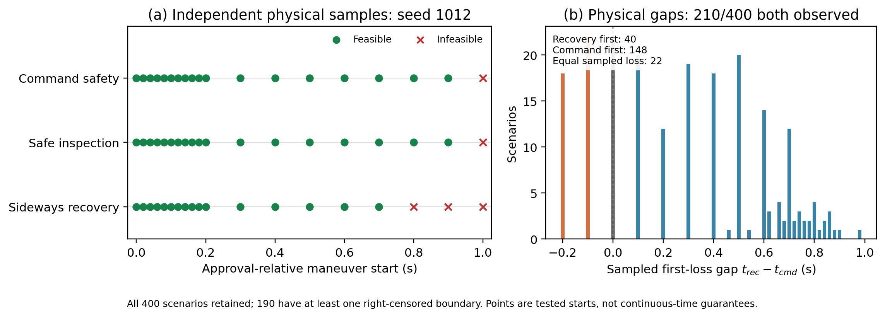

# Independent physical feasibility: supplementary results

We tested whether waiting can remove the UAV’s escape route before its approved inspection becomes unsafe. The aircraft continues North while waiting, then either dives under the bridge and swerves East around the pier, or abandons inspection and turns East beside the bridge. Across the same 400 scenarios, 11,200 new PyBullet flights plus 4,000 reused command flights establish 19-point physical feasibility profiles. Both losses are observed in 210 scenarios: 148 command-first, 40 recovery-first and 22 equal-sample cases. Recovery predictions agree with 99.61% of physical labels, but include 12 false-feasible predictions. All 400 recorded forecasts become ready at a tested safe recovery start. Existing policy results reproduce unchanged. Underpass still supplies no extra decision value for completion prediction; Geofence supplies evidence that safety and completion can differ. Use these results for the paper, retaining sampled-boundary, finite-horizon, prediction-error and simulated-timing limitations.

## Physical opportunities

Every point is a separate whole-horizon flight, including the waiting period. Safety uses unchanged 1,000 Hz monitoring; success additionally requires the original inspection dwell objective. All boundaries below mean **first tested infeasible start**, consistently for command and recovery. They are not exact latest-safe times.

| Physical ordering | Scenarios / 400 |
|---|---:|
| Command lost first; both observed | 148 (37.0%) |
| Recovery lost first; both observed | 40 (10.0%) |
| Equal first-loss samples | 22 (5.5%) |
| Command lost; recovery loss unobserved | 108 (27.0%) |
| Recovery lost; command loss unobserved | 33 (8.2%) |
| Neither loss observed through 1 s | 49 (12.2%) |

Finite positive gaps range **0.10–0.98 s** (median 0.50 s); finite negative gaps range **-0.20–-0.10 s**. Including cases with only one observed loss, command-first ordering is established in 256 scenarios and recovery-first ordering in 73; 49 remain unresolved. No physical profile returns to feasibility after its first loss. No command is safe but incomplete among 7,600 tested command flights. Command expiration is caused by the pier in 289/318 cases; all 243 observed recovery losses involve the deck’s front or front-side clearance.

Representative examples: seed **1012** loses recovery at 0.80 s and command safety at 1.00 s (gap −0.20 s); seed **1011** loses command safety at 0.04 s and recovery at 0.90 s (gap +0.86 s); seed **1005** has equal first-loss samples at 1.00 s. Seed 1222 loses recovery at 1.00 s while command safety remains unexpired on the grid.

## Prediction accuracy and readiness

| Profile | Accuracy | False-feasible: count / rate | False-reject: count / rate | Boundary MAE / median (ms) | Boundary pairs |
|---|---:|---:|---:|---:|---:|
| Command | 99.29% | 25 / 1.28% | 29 / 0.51% | 11.45 / 0 | 318 |
| Completion | 99.29% | 25 / 1.28% | 29 / 0.51% | 11.45 / 0 | 318 |
| Recovery | 99.61% | 12 / 2.18% | 18 / 0.26% | 7.17 / 0 | 237 |

Each row compares 7,600 saved prediction labels with independent physical outcomes. False-feasible rate divides by physically infeasible points; false-reject rate divides by physically feasible points. Physical command/completion losses are unobserved in 82 scenarios and recovery loss in 157; corresponding predicted counts are 79 and 156. Boundary errors exclude unobserved losses. One command/completion prediction is already infeasible at the first sample; it is explicitly flagged. One predicted command/completion profile, seed 1611, is non-monotonic; its full labels and conservative first loss are retained.

The complete predictor’s stored warmed runtime is **149.0 ms median / 167.4 ms p95**. After rounding availability to the next 50 Hz control step, **0/243** forecasts are late relative to observed physical recovery loss; 157 recovery boundaries are unobserved. All 400 readiness times exactly match tested safe recovery starts. Timely availability does not guarantee a timely or correct intervention.

## Existing policy evidence

The original 46,800-flight metrics and scenario-bootstrap confidence intervals reproduce exactly. Complete StaleGuard reduces unsafe flights from **563 to 182** versus command-only EarlyRecovery (7.33 percentage points, 95% CI 6.12–8.63), while losing **58** safe inspections. Against Fixed EarlyRecovery it preserves **1,017** inspections but incurs **65** additional unsafe flights. Of the net 381 unsafe flights prevented versus command-only EarlyRecovery, 102 are within the prediction horizon and 279 beyond it.

| Existing policy | Unsafe recoveries after correctly rejecting the scheduled unsafe command | Scenarios |
|---|---:|---:|
| Dispatch-only StaleGuard | 1226 | 321 |
| Command-only EarlyRecovery | 274 | 66 |
| Complete StaleGuard | 11 | 3 |

“Correct” here is retrospective: No Recovery at the scheduled dispatch was unsafe. Early policies do not know that future delay. At the actual early recovery starts, all 13 unsafe complete-StaleGuard recoveries still had a physically safe command alternative; 11 have an unsafe later scheduled command. Those 13 unsafe recoveries are three repeated scenario/start cases with directly false-feasible recovery predictions, not 13 independent model failures. Complete StaleGuard’s 182 unsafe flights comprise **43 dispatches before readiness, 126 unsafe commands admitted with a ready forecast, and 13 unsafe recoveries**; 119 of the ready unsafe admissions occur beyond 1 s. All 278 unsafe command-only early recoveries begin at/after the measured initial recovery loss; that policy does not forecast recovery feasibility.

## Three-mission interpretation

Archived Geofence Turn contains **2,659 safe-but-incomplete command flights in 246/300 scenarios** and 75 scenarios with three distinct positive sampled first-loss boundaries. Inspection Descent contains **265 safe-but-incomplete flights in 126/276 scenarios**; its approval-time fallback records do not establish delayed recovery deadlines. Different missions, delay grids and recovery maneuvers are not pooled.

| Claim | Assessment and remaining limitation |
|---|---|
| Claim 1 | **supported**. Sampled simulator evidence, not exact continuous-time deadlines. Underpass safety and safe completion coincide; 190 scenarios have at least one right-censored boundary. |
| Claim 2 | **partially supported**. 25 command/completion and 12 recovery false-feasible labels; censored boundary mismatches; one non-monotonic predicted command profile. Warmed offline runtimes are replayed on the simulator clock, not an asynchronous hardware demonstration. No validation beyond 1 s. |
| Claim 3 | **supported**. Trade-off, not universal dominance: complete StaleGuard sacrifices 58 safe inspections versus command-only EarlyRecovery and has 65 more unsafe flights than Fixed EarlyRecovery. No additional Underpass decision benefit from the completion condition; 279 of 381 net prevented unsafe flights versus command-only EarlyRecovery occur beyond the predictor horizon. |

RecoveryAware and DualHorizon retain identical predictions, actions and physical hashes across all 5,200 matched cases. Thus the independent decision value of completion prediction is **not demonstrated in Underpass**. All 2,085 existing result files remain unchanged. Full confusion counts, censoring, scenario counts, within/beyond-horizon comparisons and reproduction commands are in metrics.json and TECHNICAL_APPENDIX.md.
